# sg-tightener: least-privilege AWS security groups from VPC flow logs

**Tighten AWS security group inbound rules to the addresses that actually connect, driven by VPC flow
log evidence, not by a CIDR block someone typed into Terraform years ago.**

[](https://github.com/andrewbakercloudscale/sg-tightener/actions/workflows/test.yml)
[](LICENSE)


Website: <https://cloudtorepo.com/tightener.html>

> **Security groups are not static configuration.** A group written once with big IP buckets in it
> (`10.0.0.0/8`, "the data centre /16") and never changed again is a standing risk, not a finished
> job. Large on-premises CIDR blocks are the worst of it: every AWS account that trusts the corporate
> range is reachable from every laptop, build server and forgotten VM behind the VPN or Direct
> Connect. That backhaul is a single pathway from one compromised on-premises host to **every AWS
> account** that lets the range in.
>
> Shrinking those pools safely needs a **management and observability mechanism**, not a one-off
> clean-up: evidence of who really connects, a view of every network and its CIDR blocks, a timeline
> that shows the moment a change cuts someone off, and two-person approval to apply it. That is what
> sg-tightener gives teams: the confidence and the oversight to manage the size of their IP pools
> down, account by account, and keep them down.

---

## See it first

`python sg_review.py demo` writes this page for a made-up account, with no AWS access. Every graph
is a timeline: what was refused, how many addresses each rule allows that never connected, and who
is active.

**Tighten on the timeline.** The over-provisioned graph has a **Tighten** panel under it. Pull the
room back by kind (internal can keep a /24, the internet only the exact addresses), by source type,
or by name (Lambda, Zscaler or a partner keep their published range). The graph's last point drops
to what would be left, and its grey bars show refused sources, with how many the change would turn
away. Propose it (in the console, or as a plan for `sg_db.py propose --plan`); a second person
approves; it is applied in enforce mode. ▼ marks a tightening on the timeline: if the refused bars
spike after one, add the source back with **Extract rule**. In the demo, Tighten takes the account
from **102.4M never-seen addresses allowed to 208k (99.8% less)**, and the timeline shows a
tightening that cut off Lambda callers, the refusals it caused, and the range put back the next day.

| Over-provisioned, before and after | Tighten by kind, type and name |
|---|---|
| [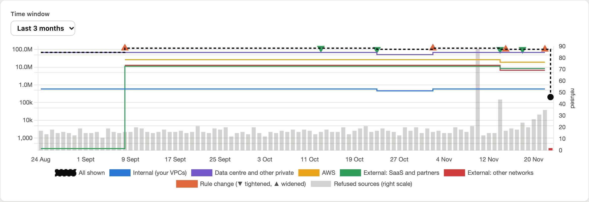](docs/images/sg-review-tighten-timeline.png) | [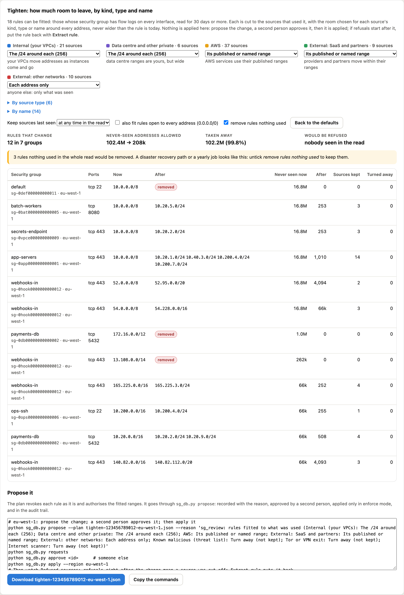](docs/images/sg-review-tighten.png) |

| Refused sources | Over-provisioned addresses | Active sources |
|---|---|---|
| [](docs/images/sg-review-refused-sources.png) | [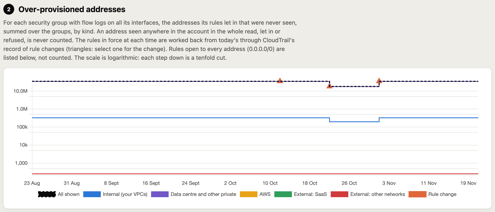](docs/images/sg-review-over-provisioned.png) | [](docs/images/sg-review-active-sources.png) |
| **By source type** | **By port class** | **Ports** |
| [](docs/images/sg-review-refused-by-source-type.png) | [](docs/images/sg-review-refused-by-port-class.png) | [](docs/images/sg-review-ports.png) |

| Extract rule: one rule per destination | What we know about a refused source |
|---|---|
| [](docs/images/sg-review-extract-rule.png) | [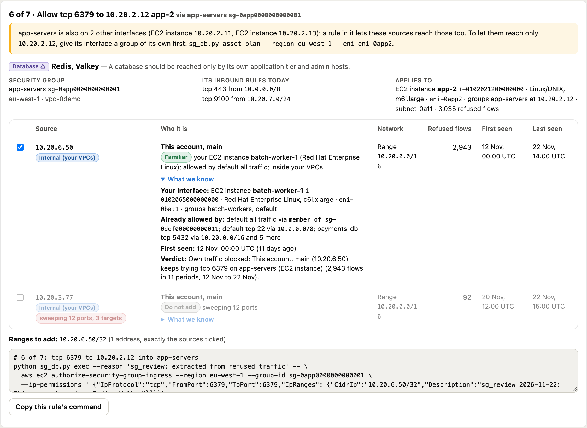](docs/images/sg-review-extract-know.png) |

| Time window: the last year, with the time not read marked No data | Blast radius of one address |
|---|---|
| [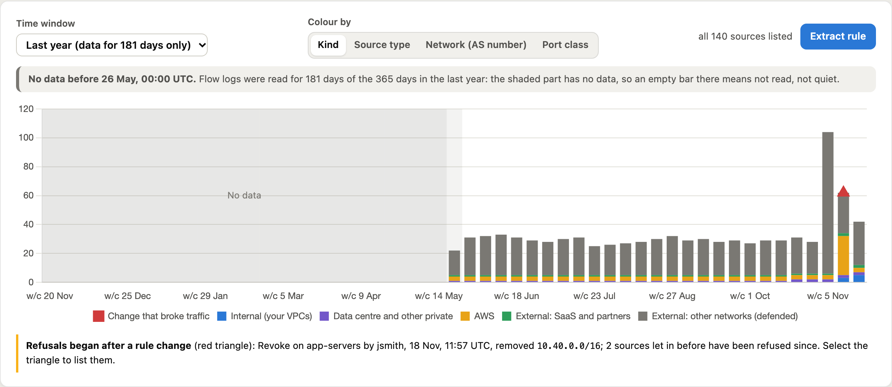](docs/images/sg-review-time-window.png) | [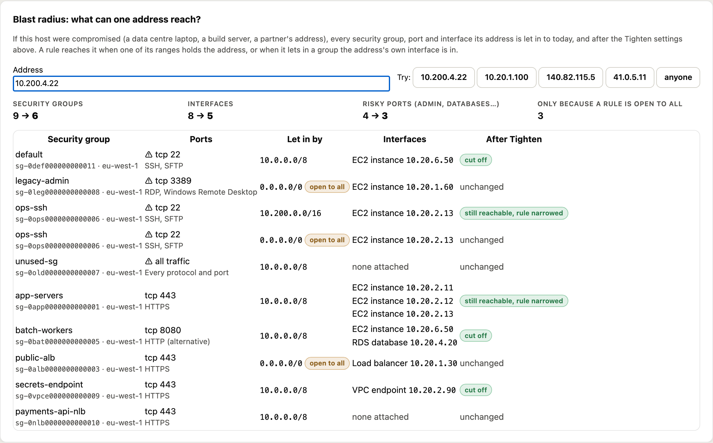](docs/images/sg-review-blast-radius.png) |
| **Over-provisioning over time, by network** | **Over-provisioning over time, by source type** |
| [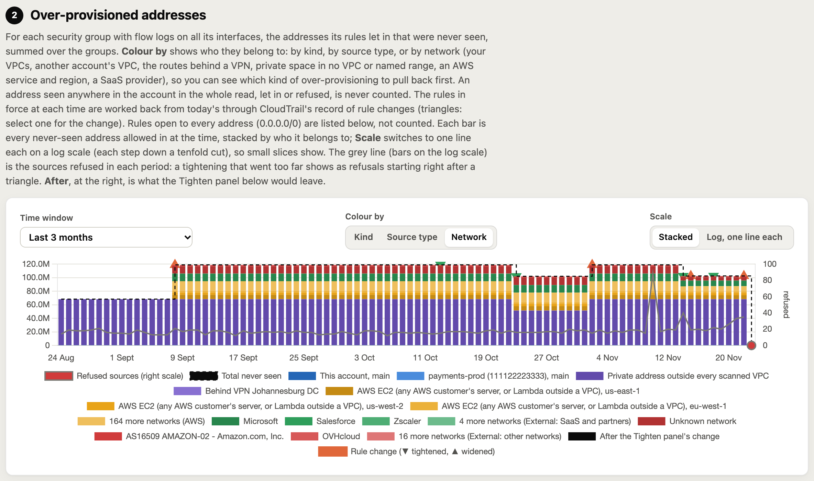](docs/images/sg-review-over-by-network.png) | [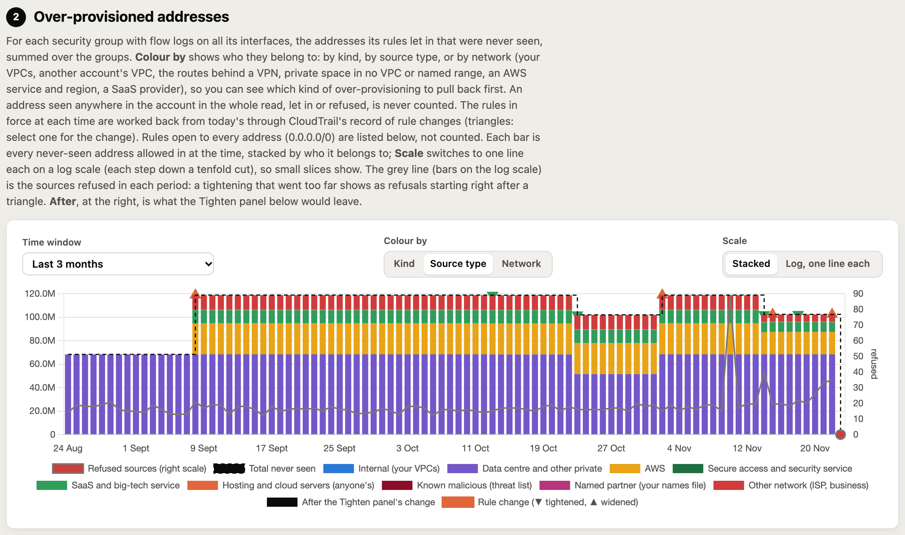](docs/images/sg-review-over-by-source-type.png) |
| **Where traffic comes from: each network's CIDR blocks** | **PrivateLink, on its own tab** |
| [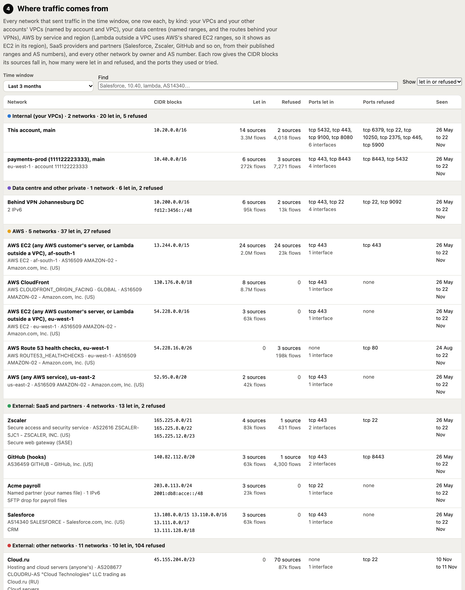](docs/images/sg-review-networks.png) | [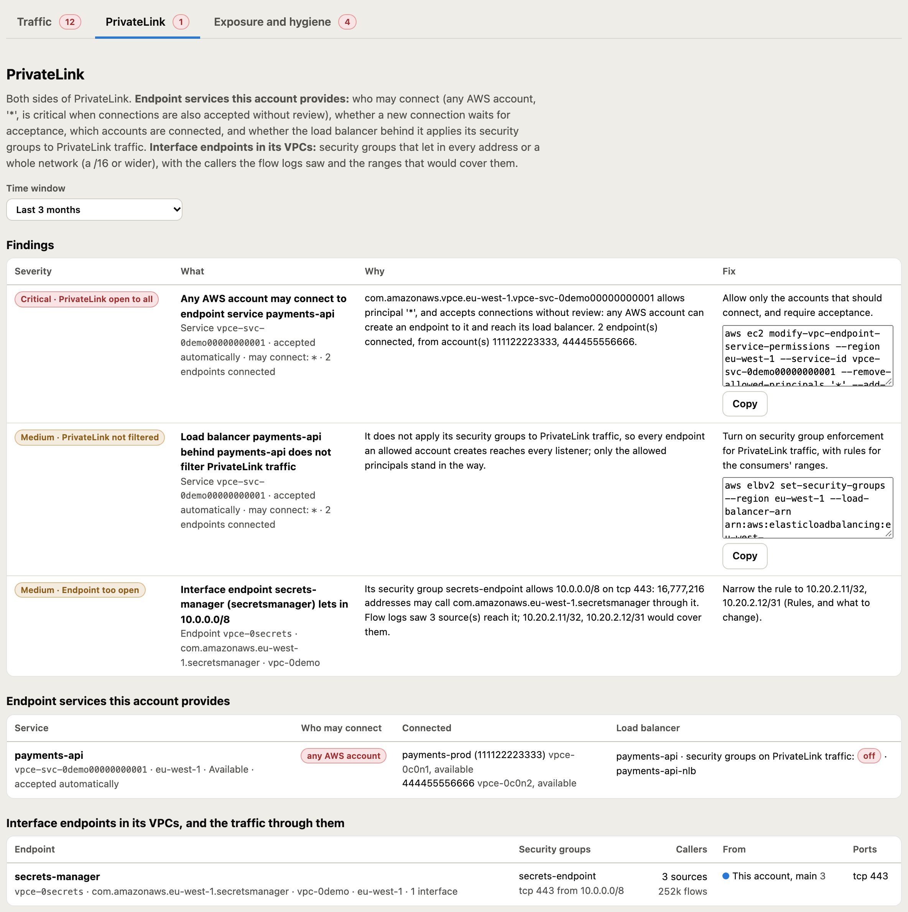](docs/images/sg-review-privatelink.png) |

**Managing the risk.** Fix what is internet-reachable before what is merely open on paper; read 90
days before removing anything; tighten remote admin and database ports first; and report two
numbers: never-seen addresses allowed, and time to restore. The full list is in
[Managing the risk](docs/security-group-review.md#managing-the-risk).

---

## The shift: IP addresses are risk, not configuration

### The old world: security groups written by hand, frozen in Terraform

Most organisations treat AWS security groups as static configuration. An engineer writes the inbound
rules once, usually in Terraform, CloudFormation or the console, and they stay there for years. Nobody
knows ahead of time exactly which servers, data centre hosts, VPN users or partner systems will call a
service, and a security group holds only about 60 rules. So people do the one thing that is sure to
work. They let in whole blocks:

```hcl
ingress {
  from_port   = 5432
  to_port     = 5432
  protocol    = "tcp"
  cidr_blocks = ["10.0.0.0/8"]   # "the corporate network": 16.7 million addresses
}
```

That habit is the problem:

- **The pools are enormous.** `10.0.0.0/8` is 16.7 million addresses. A `/16` for "the data centre" is
  65,536. The database above may have a dozen real callers.
- **The rules only ever grow.** Removing a range might break something nobody can name, so nobody
  removes it. Each new caller adds another broad block.
- **Terraform makes it permanent.** A rule in code is reviewed once, then copied into every
  environment and every module that uses it. Narrowing it by hand is reverted on the next
  `terraform apply`. Infrastructure as code is excellent for infrastructure, but a security group's
  sources are not infrastructure. They are a fact about who talks to whom, and that changes every week.
- **Trust follows the network, not the caller.** "Anything from the data centre" means any one
  compromised laptop, build server, printer or forgotten VM in that range can reach your databases,
  admin ports and internal APIs directly.

With ransomware crews, supply chain compromises and state actors all working from a first foothold
inside the network, trusting an entire data centre or corporate CIDR block is an extremely high-risk
strategy. A flat trust zone is what turns one compromised host into a breach of the whole estate:
the attacker does not need an exploit, only an address in a range you already allow.

### The new world: every allowed address is a risk to keep as small as possible

sg-tightener treats each IP address a security group lets in as **risk to be minimised**, and each
security group's limited rule slots as a **budget to spend well**:

1. **Take security groups out of Terraform, completely.** Every security group and every rule lives
   in sg-tightener's local database, with an audit trail of who changed what, when and why. Terraform
   keeps the instances, load balancers and endpoints and refers to groups by id only. The rules become
   living data, refreshed from evidence.
   [Why, and how to move out of Terraform without an outage](docs/terraform.md).
2. **Let evidence decide who gets in.** VPC flow logs show which source addresses actually reached
   which network interface, on which port, over weeks or months. Only those are kept.
3. **Let an algorithm spend the rule budget.** When the real callers do not fit in the rules a group
   has, sg-tightener chooses, exactly, the CIDR blocks that cover every caller while opening **the
   fewest addresses nobody was seen using**, and shares each group's slots among its rules where they
   save the most. A `/8` with sixteen million addresses can become a handful of `/28`s and
   `/32`s.
4. **Make it safe and repeatable.** Every change is planned, reviewed, applied with a manifest and can
   be reverted. `sg_diagnose` finds anything the tightening cut off and prints the command that
   restores it. `sg_review` shows, per rule, what is used and what is not, and alerts when something
   breaks or a rule is too open.

| | Old world | New world |
|---|---|---|
| Who decides the sources | A person, once, guessing | Flow log evidence, refreshed |
| Where the rules live | Hard-coded in Terraform | A local database with an audit trail; never Terraform |
| Typical rule | `10.0.0.0/8` or a data centre `/16` | The fewest exact blocks covering the real callers |
| Addresses let in | Millions | Tens to hundreds |
| What one compromised host can reach | Everything that trusts its network | Only what it was already talking to |
| Over time | Rules grow, never shrink | Unused access is found and removed |

The result is least-privilege network access for AWS security groups, without guessing and without
breaking production.

---

## Security groups live in a local database, not in Terraform

> **You cannot manage security groups in Terraform (or CloudFormation, CDK or Pulumi) with this
> solution.** Every security group and every rule is held in sg-tightener's local database,
> `~/.sg-tightener/sg.db`. That database is the source of truth. AWS is where the rules are
> enforced; the database is where they are decided.

Why not Terraform:

- **Two owners fight.** sg-tightener narrows rules every week from flow-log evidence. A Terraform
  resource for the same group puts the old rule back on the next `terraform apply`, or deletes the new
  ones. There is no safe split: `ignore_changes` hides real drift, and separate rule resources still
  recreate the broad rule someone revoked.
- **Sources are data, not infrastructure.** Who may reach a database changes every week. Code review
  once, at the time a rule was written, is the wrong control. The right one is evidence, a reason and
  an audit trail for every change.
- **One place to look.** With the database, every group, every rule, and every change to them (made by
  sg-tightener, by a person through `sg_db.py`, or found in AWS after someone used the console) is in
  one append-only, hash-chained log.

How it works:

- `python sg_db.py import --regions eu-west-1` takes every group and rule into the database. The
  tools import a region on first use anyway.
- Every change goes through the database with who, why and an optional ticket: `sg_tightener apply`,
  `sg_compact`, `sg_extend`, `sg_db.py add|remove|exec`. The commands `sg_review` prints run through
  `sg_db.py exec`.
- `python sg_db.py reconcile --regions eu-west-1` (hourly from cron) finds any change made in AWS
  outside the tool (console, CLI, Terraform), records it in the audit trail as external with who made
  it from CloudTrail, posts it to Slack, and prints how to put it back (`sg_db.py apply`) or keep it
  (`sg_db.py adopt`). A person decides.
- `python sg_db.py log` shows the audit trail; `python sg_db.py verify` proves nobody edited or
  removed an entry.

### One console for every account, with two-person approval

`python sg_console.py install` runs a local web console that is **always running** (starts at login;
or `serve` for now), at `http://127.0.0.1:8765/`. **Sign in on the page** with your AWS access portal
(SSO) or keys on this computer, choose **one role for every account**, tick an OU (PROD, say) and
**Read all N accounts**: the security groups go in, one price for every account's flow logs is shown
before anything is spent, the Risk overview compares them, and **Review and tighten** opens each one. No AWS CLI
or command line is needed after that. Over the database it shows every account's groups and rules, change requests to propose and approve, the audit trail
to search, a **Risk overview** of every account (a risk heatmap and over-provisioning by owner), **Over-provisioning** by account and asset rated red, amber or green, and **every rejected flow across an OU** in one table. Every change is a request with a
reason and ticket, and **a different person must approve it** before it is applied. Proposal,
approval and apply are each audited; break-glass (`sg_extend`) still goes straight through, flagged.
See [the console](docs/console.md).

| Sign in: access portal or keys | One role, choose an OU | Read them all, one price first |
|---|---|---|
| 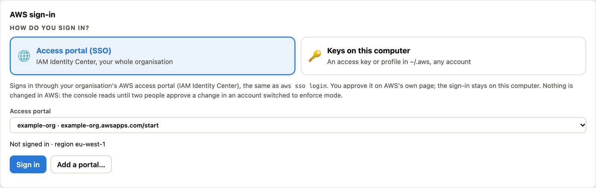 |  |  |


### Surveillance first, then apply per account, per group or per asset

Every account starts in **surveillance** mode: sg-tightener reads, reports what is over-provisioned and
what each group should be, and records change requests, but **applies nothing**. When the organisation
is comfortable:

- `sg_db.py check --regions eu-west-1 --assets` makes every write as an EC2 DryRun (nothing changes) and
  says whether this identity, with its SSO permission set, boundaries and SCPs, can apply there.
- `sg_db.py mode enforce --account 123456789012 --reason "CAB-17"` lets approved changes be applied in that
  account: the whole account (`sg_db.py apply --region R`), one group (`--group sg-…`), or **one asset**.
- **One asset**: `sg_db.py asset-plan --eni eni-…` builds a group of its own from the sources that reached
  that interface only; once approved, `asset-apply` creates `sgt-<eni>-…` and moves the interface onto it
  (`asset-revert` puts it back). Auto scaling, EKS and ECS assets are refused, since new instances start
  from the launch template: tighten the shared group, which every instance inherits.
- Every interface's groups are recorded, and every change to them is in the audit trail
  (`sg_db.py asset-log --instance i-…`, or **History** in the console).

Across an OU: `sg_db.py import|reconcile --ou-id ou-…` takes and checks every account's groups (a role
assumed in each), `sg_review.py org --ou-id ou-…` reads their flow logs, and
`sg_review.py watch --ou-id ou-… --loop` alerts on rejected traffic in any of them every 5 minutes.

If your groups are in Terraform today, [move them out once](docs/terraform.md): import them into the
database, remove them from Terraform state without destroying them, refer to them with data sources,
and deny Terraform's role the security group write calls. The database is described in
[docs/database.md](docs/database.md).

---

## How it works

sg-tightener reads your VPC flow logs, records which private source addresses actually connected to
which network interface, and replaces each security group's broad rules with the CIDR blocks that
cover the sources that reached *that group*. Within the rule limit of a security group, it chooses
the blocks that open the fewest addresses nobody was seen using. Every change is planned, reviewed,
applied with a manifest, and can be reverted.

It is a companion to [CloudtoRepo](https://cloudtorepo.com), which turns an AWS estate into
Terraform. Security groups are the exception: they live in sg-tightener's database, and Terraform
refers to them by id ([why](#security-groups-live-in-a-local-database-not-in-terraform)).

---

## What it changes, and what it never touches

| Changed | Never touched |
|---|---|
| IPv4 ingress rules whose source is inside RFC 1918 (`10/8`, `172.16/12`, `192.168/16`) **and** wider than `/24` | `0.0.0.0/0` and any public CIDR |
| IPv6 ingress rules wider than `/64` that are unique local (`fc00::/7`) or inside the region's VPC IPv6 blocks (clients are kept by `/64`) | `::/0` and any other public IPv6 range |
| | Security-group references and prefix lists |
| | Egress rules and network ACLs |
| | Rules already at `/24` or narrower |
| | Groups on a Network Load Balancer behind a PrivateLink endpoint service (consumers' addresses are not in your flow logs) |
| | Groups whose interfaces are not covered by the flow logs analysed |

The `/24` cut-off is configurable with `--prefix-threshold`. Held-back groups
are listed in the plan under `skipped_groups` with the reason.

---

## What's new

| Version | Highlights |
|---|---|
| **5.16.1** | **Role in every account** at the top of Read your accounts: change it once for every chosen account; no per-account role column |
| **5.16.0** | **Reading an OU reads only accounts that spend** (over US$100 in the last 30 days by default, from Cost Explorer in the management account; 0 reads every one), shows the **time left**, and **leaves out security groups on no interface** |
| **5.15.0** | **Read a whole OU from the console.** Sign in with the access portal or keys on this computer, choose **one role for every account**, tick an OU (PROD, say) to choose every account in it, then **Read all N accounts**: security groups first, one price for every account's flow logs, one click to read them all (4 at a time, with Stop). Then the Risk overview and Over-provisioning compare them, and Review and tighten dives into one |
| **5.14.0** | **No token to open the console, loading animations, SSO with many accounts.** The console opens at `http://127.0.0.1:8765/` with AWS SSO as the sign-in (other web pages still cannot use it: a page-held key on every change, cross-site and foreign-origin requests refused, Host check). A loading bar and spinners show whenever something loads. Listing accounts no longer fails with `TooManyRequestsException` on large organisations |
| **5.13.0** | **Over-provisioning for leaders: by account, per asset, red/amber/green.** A console tab rates every asset by its over-exposure (never-seen addresses that can reach it: green up to a /24, amber up to a /16, red above or open on a risky port), with KPIs (addresses allowed and their change, % of assets right-sized against a 90% target, red and amber counts, average per asset, accounts green, assets left to fix), the trend, each account's rating with **Reduce** into its Tighten panel, and the rules that would fix the most |
| **5.12.0** | **Risk overview across every account.** A new console tab puts every account read side by side: headline tiles, a **risk heatmap** (eight dimensions per account, worst first), **over-provisioned by owner** (internal, data centre, AWS, SaaS, other networks, or by source type; size or share), over-provisioning and high-risk probing over time, rules open to the internet on risky ports, high-risk sources let in, the biggest rules to tighten, and blind spots |
| **5.11.0** | **Refused timeline you can zoom, with a risk counter, and a guarded Extract rule.** A counter of refused addresses (High risk, Other external, Yours, AWS and SaaS) and a red line of high-risk sources; anything scanning ports is flagged **High risk**. Drag across the graph to zoom into a period, then **Extract rule** walks through Period, Sources, Rules, Apply: high-risk and external sources are held back and need a reason (and `add high risk` typed) to be added, recorded in the command and the audit trail |
| **5.10.0** | **Look up ports.** In Where traffic comes from, **Look up ports** under each network's ports lists what every port is commonly used for (`tcp 5432` PostgreSQL · Database), with ⚠ on remote admin, database, Windows and container ports; hover a port for the same, and **Find** matches service names (`postgres`, `smb`). Console sign-in: **Open the AWS sign-in page again** is a button, with **Copy sign-in link** for a private window when a VPN change blocks the company sign-in |
| **5.9.0** | **A web console for everyone, always running, with AWS SSO sign-in.** `sg_console.py install` (or the **Always running** switch) keeps the console running in the background at a bookmarkable address. **Sign in with AWS SSO** on the page (IAM Identity Center device sign-in, no AWS CLI needed; an `aws sso login` session is reused), choose your accounts and a role in each, and **Read**: security groups go into the console, the flow-log cost is shown before it is spent, with progress and Stop, then **Review and tighten** |
| **5.8.1** | **Unused addresses by owner, as a stacked timeline.** The over-provisioned graph now stacks the never-seen addresses allowed in at each time by who they belong to (internal, data centre, AWS, SaaS, other), so you see both how many and whose, and each tightening as a step down. **Scale** switches to one line each on a log scale |
| **5.8.0** | **Over-provisioning by type and owner, over time.** The over-provisioned graph has **Colour by**: kind, source type, or network, so you can see who the never-seen addresses belong to (your VPCs, other accounts, the routes behind a VPN, private space nobody uses, AWS by service and region, SaaS providers) and which to pull back first |
| **5.7.1** | **Five fixes from testing.** A range several accounts share (every default VPC) is no longer pinned on one of them; your names file and `--onprem` win over automatic account naming; `forget` removes the account from `vpcs.json`; unattributed sources show their address as the block; AWS's catch-all range is no longer "AWS AWS" |
| **5.7.0** | **Where traffic comes from, and PrivateLink on its own tab.** A new table lists every network sending or receiving traffic, grouped by kind, with its CIDR blocks: on-premises (from VPN routes), your other AWS accounts (now named automatically once read), AWS services by region, Lambda outside a VPC, and SaaS such as Salesforce, Zscaler, Okta and GitHub. The page is split into Traffic, PrivateLink and Exposure tabs; PrivateLink lists every endpoint service and interface endpoint with the traffic through it |
| **5.6.0** | **Every graph windowed, and no data shown as no data.** The **Time window** drop-down is now also on Needs attention and Ports, and every window can be chosen. When a window reaches back further than the flow logs read, each graph says so ("No data before 26 May: 181 of 365 days read"), shades the time not read as **No data**, and the command to fill it is given. The console's rejected traffic says which accounts have no data that far back |
| **5.5.0** | **Time window drop-down, up to a year.** Each timeline has a **Time window** drop-down (last 24 hours, week, month, 3 months, 6 months, year), kept in step with the one at the top. `sg_review.py read --days 365` reads a year, shown a bar a week, to catch yearly traffic before a rule is removed. The console's rejected traffic also offers the last year |
| **5.4.0** | **Extract rule: what we know, one destination at a time.** Refused traffic is let in **one rule per destination address**, numbered, each card with its own command and **Propose this one in the console**, and a warning (with the `asset-plan` command) when the destination's group is shared. Each source is marked **Familiar**, **Unfamiliar** or **Do not add**, and **What we know** shows the evidence: your instance behind the address (Name tag, **operating system**, type, groups), ports it is already let in on, rules that already allow it, first seen, what else it was refused on, and the verdict. The review reads each instance's name and OS |
| **5.3.0** | **Known malicious addresses**: every source and outbound destination is checked, locally and daily, against free threat lists (abuse.ch Feodo Tracker botnet servers, Spamhaus DROP, Emerging Threats compromised hosts, blocklist.de attackers) as well as Tor exits. Let in on admin or database ports, or called out to, is **critical** and always posted by `watch`; Tighten turns such sources away by default; the console marks and filters them. **Alerting scripts** in `deploy/alerts` (systemd, launchd, cron) for `watch`, hourly `reconcile` and a daily read. **`install.sh`** checks every package, downloads the address lists, and takes `--dev`; tools run outside the venv say how to install |
| **5.2.0** | **Blast radius**: type one address in the Security Group Review (or run `sg_review.py reach ADDRESS`) and see every rule that admits it, worst first, with the interfaces behind each group, risky ports marked and rules open to all counted apart. It follows the Tighten panel: each row shows unchanged, narrowed or cut off, and the summary shows the reach after. In the demo a data centre host goes from 9 groups on 8 interfaces to 6 on 5. New **Managing the risk** guidance: the order to tighten in, flow-log blind spots, egress, hygiene, and the two numbers to report |
| **5.1.0** | **Tighten on the timeline**: the Security Group Review's over-provisioned graph gets a **Tighten** panel. Pull each rule back to the sources that used it, with the room chosen by kind (internal, data centre, AWS, SaaS, internet), source type or name (a published or named range for Lambda, Zscaler or a partner); the graph shows the After point and the sources the change would refuse; ▼/▲ mark tightenings and widenings; rules nothing used are removed by default. In the demo, 102.4M never-seen addresses allowed become 208k. Propose it from the page in the console (**Review and tighten** on the Overview, `/review?account=ID`) or as a plan for `sg_db.py propose --plan`; two-person approval and enforce mode still apply |
| **5.0.0** | **Surveillance first**: every account starts in surveillance mode (report and propose, never apply) until `sg_db.py mode enforce --account ID`, which needs a passing **DryRun permission check** (`sg_db.py check`); apply checks again before any change. **Per-asset groups**: `asset-plan`/`asset-propose`/`asset-apply`/`asset-revert` give one interface a group of its own from its own flows, with every asset's group changes in the audit trail (`asset-log`); auto scaling, EKS and ECS assets are refused in favour of the shared group. **IPv6**: sources named (providers, Tor, scanners, internal vs external) and private IPv6 rules tightened. **New addresses**: each source's first sighting, with "new" (never seen before) on the page, in the console, in `watch` alerts |
| **4.0.0** | **Security group console** (`sg_console.py serve`): one local web page for every account's groups and rules, change requests, the audit trail, and every rejected flow across an OU, with "Propose allowing" from a refused flow. **Two-person approval, on by default**: every change is a request with a reason and ticket that a different person approves before it is applied; `sg_tightener apply` and `sg_compact apply` now propose (`sg_db.py propose --plan`), break-glass still goes through. **Across an OU**: `sg_db.py import`/`reconcile --ou-id`, `sg_review.py watch --ou-id`, and an **All rejected traffic** table on the org page |
| **3.0.0** | **Security groups live in a local database** (`sg_db.py`): every group and rule in SQLite, every change with who, why and ticket in an append-only, hash-chained audit trail. `reconcile` records changes made outside the tool (console, CLI, Terraform), names who from CloudTrail, and offers to put them back. sg_tightener, sg_compact, sg_extend and the fixes `sg_review` prints all go through it. **Terraform cannot manage security groups with this solution**: [move out once](docs/terraform.md). **Real-time alerts are for rejected traffic**: `watch --loop` every 5 minutes reads up to five minutes ago. The 2.8.0 drift Lambda is removed |
| **2.8.0** | Real-time drift alerts by EventBridge and Lambda (removed in 3.0.0: alerts are on rejected traffic, and changes made outside the tool are found by `sg_db.py reconcile`). It alerted within seconds when a security group rule is opened wide, naming who and from where, to SNS, Slack and Security Hub, and can revoke it automatically (`AutoRevoke`, with a tag to exempt groups meant to be public) |
| **2.7.0** | Security posture. `sg_review` finds rules the internet can actually reach (public address, internet-gateway route, network ACLs), wide IPv6 ranges, the default group in use, cross-account and stale references, and, with `read --egress`, outbound connections to Tor or scanners and outbound rules fitted to what was used. A rule opened wide in the last day is a **Needs attention** item at once, so `watch` alerts within the hour. Findings go to **AWS Security Hub** (`securityhub`, `--securityhub`). `sg_ou_report` adds reachability notes, IPv6 and hygiene rows. **SSO**: `--profile` on every tool and a one-line `aws sso login` hint. Least-privilege `iam-policy-read.json` / `iam-policy-write.json`, and signed plans and manifests that `apply` and `revert` check |
| **2.6.0** | PrivateLink that is too open, on both sides: endpoint services any AWS account may connect to (critical when connections are accepted without review), load balancers that do not filter PrivateLink traffic, and interface endpoints whose security group lets in a whole network, each with the command that fixes it, in `sg_review` (and its Needs attention, `watch` and `org`) and in `sg_ou_report` |
| **2.5.0** | `sg_review.py` verdicts: every refused and let-in source gets a severity and a one-line reason, and a **Needs attention** box lists only what looks broken (a rule change that cut traffic off, with the command to restore it; a partner's new address; your own traffic refused; health checks refused) or too open (scanners and Tor exits let in), worst first. Scans turned away stay out. A red triangle marks the change that broke traffic. `watch` posts new items to Slack or email; `org` rolls the verdicts up across every account in an OU |
| **2.4.0** | `sg_review.py`: a self-contained HTML Security Group Review of one account over 24 hours to 6 months. Three timelines (refused sources, over-provisioned addresses worked back through CloudTrail's rule changes, active sources with DR and batch traffic apart), every source named and typed (AWS service, CDN, secure access, SaaS, anyone's hosting, scanner, Tor exit, your partners via a names file), graphs by port class, **Extract rule** to turn refused sources into reviewed rules, each rule's status and suggested ranges, CSV and approved.json downloads. Moved here from the AWS Cloud Risk Review console |
| **2.3.0** | Exact rule fitting: when sources do not fit the rule limit, the blocks that open the fewest unused addresses are chosen, and a group's slots go to the rules where they save the most. Fitting 2,000 addresses takes 0.02 s instead of up to 28 s |
| **2.2.0** | Interface-exact evidence: flows record the interface that logged them, so overlapping VPCs stay apart. `sg_diagnose` judges each refused flow against its destination's own groups, and `--manifest` marks what a tightening caused. `sg_viz` resolves EKS pod prefixes and security-group references. Org reports say which accounts could not be scanned (`scan_status`, exit code 2) and treat `::/0` as public |
| **2.1.0** | PrivateLink NLB groups and groups outside flow-log coverage are held back. `-1` (all traffic) rules apply cleanly. `sg_compact` revert keeps descriptions. `sg_extend` grants AWS-service ranges only to the groups that received that traffic and reports unknown `--groups` ids up front |

Full history: [CHANGELOG.md](CHANGELOG.md).

---

## The tools

| Script | Job | Writes to AWS? |
|---|---|---|
| [`sg_assets.py`](sg_assets.py) | Every network interface and its groups, and a group of its own for one asset from its own flows (used by `sg_db.py assets`, `asset-plan`, `asset-apply`) | Creates `sgt-<eni>-…` and moves the interface onto it, in enforce mode, once approved |
| [`sg_console.py`](sg_console.py) | Local web console over the database: every account's groups, change requests to propose and approve, the audit trail, rejected traffic across an OU | Apply and reconcile from the page, recorded in the database |
| [`sg_sso.py`](sg_sso.py) | AWS SSO (IAM Identity Center) sign-in for the console: the device sign-in, your accounts and roles, short-lived credentials per account | Nothing (reads only) |
| [`sg_db.py`](sg_db.py) | The security group database: `import`, `reconcile` (one account or an OU), change requests (`add`/`remove`/`exec`/`propose`, `approve`/`reject`/`cancel`), `apply`, `adopt`, `create-group`, `log`, `verify` | `apply`, `exec`, `create-group`; every change recorded |
| [`sg_tightener.py`](sg_tightener.py) | Main loop: `analyse` → `plan` → `apply` → `revert` | `apply` and `revert` only, recorded in the database |
| [`sg_diagnose.py`](sg_diagnose.py) | After an apply: find private sources the destination's groups now refuse, mark what the tightening caused, print the command that restores them | No |
| [`sg_extend.py`](sg_extend.py) | Break-glass: add rules for rejected traffic during an incident (additive only) | Yes, adds only, recorded in the database |
| [`sg_compact.py`](sg_compact.py) | Merge narrow CIDRs into wider ones to get back under the rule limit | `apply` and `revert` only, recorded in the database |
| [`sg_ou_report.py`](sg_ou_report.py) | Rank every account in an AWS Organization by permissive SG and NACL rules; exit 1 on CRITICAL, 2 if any account could not be scanned | No |
| [`sg_transfer_audit.py`](sg_transfer_audit.py) | Find AWS Transfer Family servers (SFTP/FTPS/FTP/AS2) open to the internet; same exit codes | No |
| [`sg_review.py`](sg_review.py) | One account's inbound rules against months of flow logs, as one HTML page with what needs attention, three timelines and what to change; `watch` alerts on rejected traffic to Slack or email (one account or an OU), `org` rolls up an OU with every rejected flow; `sg_review.py demo` shows it without AWS | No |
| [`sg_viz.py`](sg_viz.py) | Export who talked to what, accepted or rejected, per time bucket, with the rule that allowed it and what a plan would block | No |
| [`tests/`](tests) | Offline test suite (unit + moto integration), no AWS credentials needed | No |

---

## Security Group Review

`sg_review.py` writes one account's inbound rules, set against months of flow logs, as a single HTML
page. The page has three timelines (refused sources, over-provisioned addresses, active sources), a
ports view, and a table of what to tighten, with CSV and approved.json downloads. Try it with
`python sg_review.py demo`, which needs no AWS access.

- **Needs attention:** every refused and let-in source gets a verdict with a severity and a
  one-line reason, from what was already read. The box at the top lists only what looks broken (a
  rule change that cut traffic off, with the command that restores it; a partner's new address; your
  own traffic or AWS health checks refused) or too open (scanners and Tor exits let in on remote
  admin), worst first. Scans the defences turned away stay out. `watch --loop` posts new
  **rejected-traffic** items, and any known malicious address let in or called out to, to Slack or
  email within minutes (every 5 minutes; `--alerts all` adds the rest); `org` rolls them up across
  every account in an OU. Ready-made systemd, launchd and cron jobs for the alerts and the hourly
  `reconcile` are in [`deploy/alerts`](deploy/alerts/README.md).
- **Attribution:** every source is named: your VPCs and named ranges, your data centres, the AWS
  service and region, the SaaS provider, or the AS number, owner and country. The graphs can be
  coloured by kind, by network (AS number) or by port class.
- **Source type:** each SaaS or internet source is typed from a built-in list of AS numbers and
  owner names: CDN, secure access service (Zscaler, Netskope and the like), SaaS, anyone's hosting,
  internet scanner (Censys, Shodan and others), Tor or VPN exit (with the Tor Project's exit
  list), or **known malicious**: on a free threat list (abuse.ch Feodo Tracker botnet servers, Spamhaus
  DROP, Emerging Threats compromised hosts, blocklist.de attackers), checked locally and daily. A
  known malicious address let in on admin or database ports, or called out to, is critical, and
  Tighten turns such sources away by default
  ([how](docs/security-group-review.md#known-malicious-addresses-tor-and-the-threat-lists)). A names
  file adds your partners, or your own bad addresses (`type: threat`), by range or AS number.
- **Ports:** the busiest refused and let-in ports, each with its service and class (web, remote
  admin, database, Windows and directory, containers and more). Risky classes are marked ⚠.
- **Tighten:** under the over-provisioned graph, fit each rule to the sources that used it, with
  the room chosen by kind, source type or name, and see the After point and who would be refused
  before proposing it ([how](docs/security-group-review.md#tighten-pull-the-room-back-by-kind-type-and-name)).
- **Blast radius:** type one address and see every rule that admits it, the interfaces behind
  each group, and what Tighten would leave; `sg_review.py reach ADDRESS` does the same from the
  command line ([how](docs/security-group-review.md#blast-radius-what-can-one-address-reach)).
- **Extract rule:** on the refused graph, this turns the sources selected into the inbound rules
  that would let them in, **one rule per destination address**, numbered, each with its own command
  (or console proposal), so nothing is added in one go. Each source is marked **Familiar**,
  **Unfamiliar** or **Do not add**, with what vouches for it: your own instance (its name and
  operating system), ports it is already let in on, rules that already allow it, how long it has been
  seen, its owner and network, or a threat list. Nothing is applied
  ([how](docs/security-group-review.md#extract-rule)).

The graphs are [at the top of this page](#see-it-first).

| Parameter | What it changes |
|---|---|
| `read --regions eu-west-1,us-east-1` | Regions read; one page covers them all |
| `read --days 1\|7\|30\|90\|180\|365` | How far back. This decides which **Time window** choices (last 24 hours, week, 1/3/6 months, year) work. Start with `1`, which measures the cost of longer reads; each read asks before spending |
| `read --profile P` / `--name N` / `--yes` | Credentials, the account name shown on the page, and skipping the `yes` prompt |
| `report --onprem "10.200.0.0/16 Johannesburg DC"` | Names your data centres (purple in the graphs) |
| `report --internal "10.40.0.0/16 Payments prod"` | Counts your other accounts' ranges as internal (blue) |
| `report --names partners.yaml` | Your own names for partners and other networks, by range or AS number (default `~/.sg-tightener/names.yaml`; `sg_review.py names` writes an example) |
| `report --offline` / `--out FILE` | Skips refreshing the public address lists; sets the output file |

The full guide, with each graph explained, is [docs/security-group-review.md](docs/security-group-review.md).

## Quick start

```bash
git clone https://github.com/andrewbakercloudscale/sg-tightener.git
cd sg-tightener
./install.sh --dev                   # venv, every package (checked), the address and threat lists
source .venv/bin/activate
python -m pytest                     # all tests should pass
```

`install.sh` creates `.venv`, installs `requirements.txt` (boto3, pandas, openpyxl, PyYAML), checks
each one imports, and downloads the public address lists once. `--dev` adds pytest and moto. Run
outside the venv, the tools say to run `./install.sh` rather than fail with a traceback. Everything is
kept locally: security groups, rules and the audit trail in one **SQLite** file
(`~/.sg-tightener/sg.db`, or `$SG_TIGHTENER_DB`), flow-log reads in `~/.sg-tightener/review/`, the
address lists in `~/.sg-tightener/ipintel/`. No server or hosted database is needed.

Requires Python 3.9 or later and AWS credentials: read-only
[`iam-policy-read.json`](iam-policy-read.json) for everything except changes,
and [`iam-policy-write.json`](iam-policy-write.json) (one VPC) to apply them
([permissions](docs/permissions.md)). AWS IAM Identity Center (SSO) works:
see [SSO](docs/cli-reference.md#sso-and-profiles).

```bash
# 0. Take every security group and rule into the database (the tools do this on first use too),
#    and run reconcile hourly from cron so changes made outside the tool are recorded and reported
python sg_db.py import --regions eu-west-1
python sg_db.py reconcile --regions eu-west-1 --slack "$WEBHOOK"

# Optional, and a good start: see what each rule is used for, as one HTML page
python sg_review.py read --regions eu-west-1 --days 1     # measures what longer reads cost
python sg_review.py read --regions eu-west-1 --days 90    # asks before spending
python sg_review.py report --onprem "10.200.0.0/16 Johannesburg DC"   # sg-review-<account>.html
python sg_review.py watch --regions eu-west-1 --slack "$WEBHOOK" --loop   # rejected traffic, every 5 minutes

# 1. Learn: read 90 days of accepted flows and write approved.json
#    (each source and the destination address and port it reached)
python sg_tightener.py analyse --region eu-west-1 \
  --log-group /aws/vpc/flowlogs --days 90 --out approved.json

# 2. Plan: work out the replacement rules (reads AWS, writes nothing).
#    Each group keeps only the sources that reached its own interfaces.
python sg_tightener.py plan --region eu-west-1 \
  --approved approved.json --out plan.json

# 3. Review plan.json by hand. Then apply (region comes from the environment)
AWS_REGION=eu-west-1 python sg_tightener.py apply --plan plan.json

# 4. Watch for anything legitimate that is now blocked
#    (--manifest marks flows the apply's revoked rules used to admit)
python sg_diagnose.py --region eu-west-1 --log-group /aws/vpc/flowlogs --hours 24 \
  --approved approved.json --manifest manifest-<timestamp>.json

# Optional: see who talks to what, and what the plan would cut off, before applying
python sg_viz.py export --region eu-west-1 --log-group /aws/vpc/flowlogs --days 7 \
  --plan plan.json --out viz-data.json

# 5. Undo, if needed
python sg_tightener.py revert --manifest manifest-<timestamp>.json
```

---

## Documentation

| Document | Read it when |
|---|---|
| [Moving security groups out of Terraform](docs/terraform.md) | Your security groups are in Terraform: this solution cannot work with that. How to move them into the database once, without an outage |
| [The console](docs/console.md) | You want the web console: its tabs, two-person approval, who acts, and its security model |
| [The security group database](docs/database.md) | You want the schema, the audit trail, desired and synced rules, reconcile, and backups |
| [How it works](docs/how-it-works.md) | You want to understand the algorithm and the safety design |
| [Runbook](docs/runbook.md) | You are about to tighten a real account, or are mid-incident |
| [CLI reference](docs/cli-reference.md) | You need every flag and default for every tool |
| [Flow-log requirements](docs/flow-logs.md) | Before your first `analyse`, especially behind a transit gateway |
| [Security Group Review](docs/security-group-review.md) | You want the HTML report: its parameters, its graphs, port classes, and Extract rule |
| [File formats](docs/file-formats.md) | You are reviewing a `plan.json`, editing an `approved.json` or reading `viz-data.json` |
| [Permissions](docs/permissions.md) | You are creating the IAM role the tools run as |
| [Alerting scripts](deploy/alerts/README.md) | You want `watch` and `reconcile` running unattended: systemd, launchd and cron, with Slack and email |

---

## Safety in one paragraph

Every security group change is recorded in the database, with who and why, and nothing else may
change a group: changes made outside are found by `reconcile`. `plan` never writes. `apply` asks you to type `yes`, refuses to run if any
security group in the region changed since the plan was made, revokes and
authorises one group at a time, stops at the first failure, and always leaves a
manifest that `revert` replays in reverse. `sg_extend` only ever adds. Even so,
flow logs only show traffic that happened inside the window you analysed:
quarterly DR tests, year-end batch jobs and dormant blue/green stacks may be
missing. Read [the runbook](docs/runbook.md) before applying to production.

---

## Contributing

Bug reports and pull requests are welcome. Run `python -m pytest`
before opening a PR; CI runs the same suite on Python 3.9 to 3.12. See
[CONTRIBUTING.md](CONTRIBUTING.md).

## License

[MIT](LICENSE) © 2026 Andrew Baker
