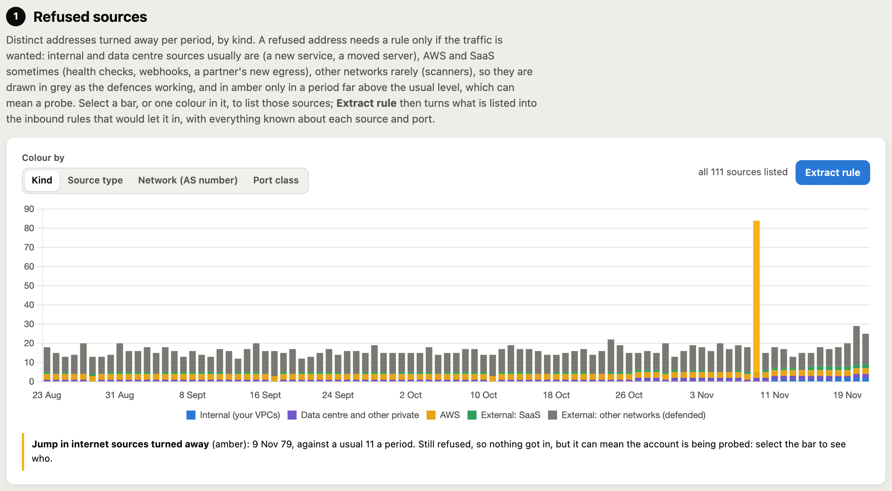
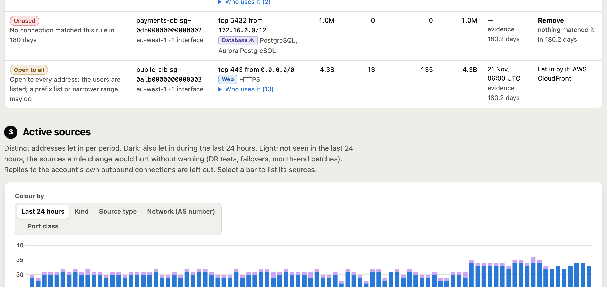
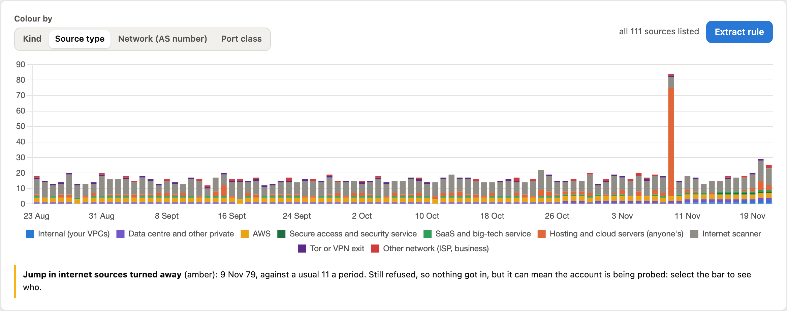
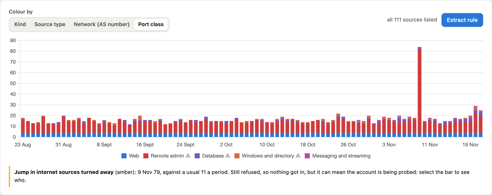
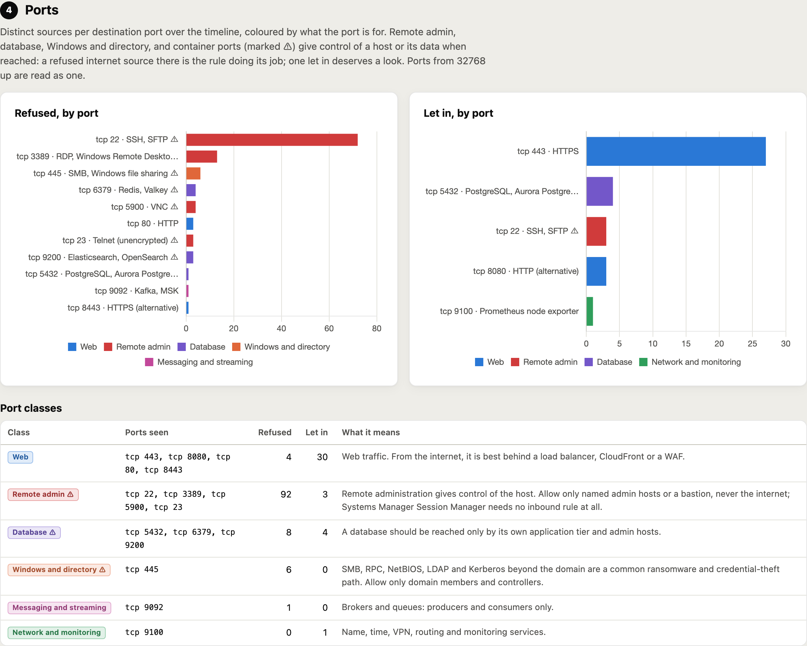
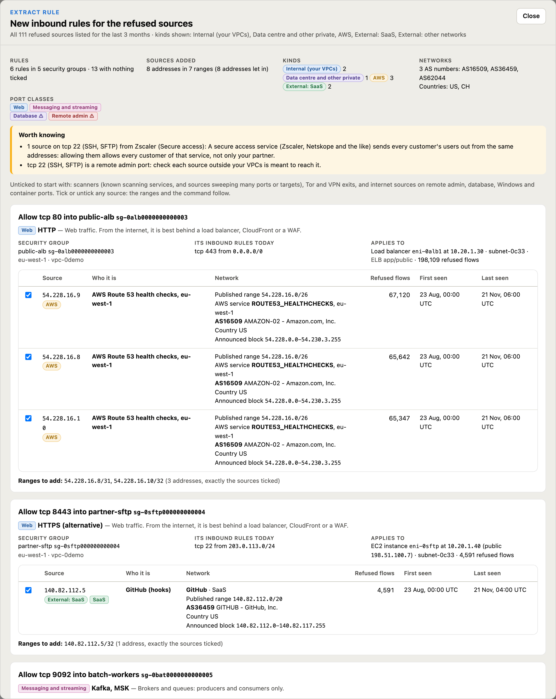

# sg-tightener

**Evidence-based tightening of AWS security groups, driven by VPC flow logs.**

[](https://github.com/andrewbakercloudscale/sg-tightener/actions/workflows/test.yml)
[](LICENSE)


Website: <https://cloudtorepo.com/tightener.html>

Most enterprise AWS estates allow inbound traffic from broad private ranges such
as `10.0.0.0/16` because that is what the corporate network was once assumed to
need. Nobody knows which of those addresses still connect, so nobody dares
narrow the rule.

sg-tightener answers that question with evidence. It reads your VPC flow logs,
records which private source addresses actually connected to which network
interface, and replaces each group's broad rules with the CIDR blocks that
cover the sources that reached *that group*, choosing, within the 60-rule limit
of a security group, the blocks that open the fewest addresses nobody was seen
using. Every change is planned, reviewed, applied with a manifest, and can be
reverted.

It is a companion to [CloudtoRepo](https://cloudtorepo.com), which turns an AWS
estate into Terraform.

---

## What it changes, and what it never touches

| Changed | Never touched |
|---|---|
| IPv4 ingress rules whose source is inside RFC 1918 (`10/8`, `172.16/12`, `192.168/16`) **and** wider than `/24` | `0.0.0.0/0` and any public CIDR |
| | Security-group references and prefix lists |
| | IPv6 rules |
| | Egress rules and network ACLs |
| | Rules already at `/24` or narrower |
| | Groups on a Network Load Balancer behind a PrivateLink endpoint service (consumers' addresses are not in your flow logs) |
| | Groups whose interfaces are not covered by the flow logs analysed |

The `/24` cut-off is configurable with `--prefix-threshold`. Held-back groups
are listed in the plan under `skipped_groups` with the reason.

---

## What's new

| Version | Highlights |
|---|---|
| **Unreleased** | `sg_review.py`: a self-contained HTML Security Group Review of one account over 24 hours to 6 months. Three timelines (refused sources, over-provisioned addresses worked back through CloudTrail's rule changes, active sources with DR and batch traffic apart), every source named (AWS service, SaaS, AS number, your data centres), each rule's status and suggested ranges, CSV and approved.json downloads. Moved here from the AWS Cloud Risk Review console |
| **2.3.0** | Exact rule fitting: when sources do not fit the rule limit, the blocks that open the fewest unused addresses are chosen, and a group's slots go to the rules where they save the most. Fitting 2,000 addresses takes 0.02 s instead of up to 28 s |
| **2.2.0** | Interface-exact evidence: flows record the interface that logged them, so overlapping VPCs stay apart. `sg_diagnose` judges each refused flow against its destination's own groups, and `--manifest` marks what a tightening caused. `sg_viz` resolves EKS pod prefixes and security-group references. Org reports say which accounts could not be scanned (`scan_status`, exit code 2) and treat `::/0` as public |
| **2.1.0** | PrivateLink NLB groups and groups outside flow-log coverage are held back. `-1` (all traffic) rules apply cleanly. `sg_compact` revert keeps descriptions. `sg_extend` grants AWS-service ranges only to the groups that received that traffic and reports unknown `--groups` ids up front |

Full history: [CHANGELOG.md](CHANGELOG.md).

---

## The tools

| Script | Job | Writes to AWS? |
|---|---|---|
| [`sg_tightener.py`](sg_tightener.py) | Main loop: `analyse` → `plan` → `apply` → `revert` | `apply` and `revert` only |
| [`sg_diagnose.py`](sg_diagnose.py) | After an apply: find private sources the destination's groups now refuse, mark what the tightening caused, print the command that restores them | No |
| [`sg_extend.py`](sg_extend.py) | Break-glass: add rules for rejected traffic during an incident (additive only) | Yes, adds only |
| [`sg_compact.py`](sg_compact.py) | Merge narrow CIDRs into wider ones to get back under the rule limit | `apply` and `revert` only |
| [`sg_ou_report.py`](sg_ou_report.py) | Rank every account in an AWS Organization by permissive SG and NACL rules; exit 1 on CRITICAL, 2 if any account could not be scanned | No |
| [`sg_transfer_audit.py`](sg_transfer_audit.py) | Find AWS Transfer Family servers (SFTP/FTPS/FTP/AS2) open to the internet; same exit codes | No |
| [`sg_review.py`](sg_review.py) | One account's inbound rules against months of flow logs, as one HTML page with three timelines and what to change; `sg_review.py demo` shows it without AWS | No |
| [`sg_viz.py`](sg_viz.py) | Export who talked to what, accepted or rejected, per time bucket, with the rule that allowed it and what a plan would block | No |
| [`tests/`](tests) | Offline test suite (unit + moto integration), no AWS credentials needed | No |

---

## Security Group Review

`sg_review.py` writes one account's inbound rules, set against months of flow logs, as a single HTML
page. The page has three timelines (refused sources, over-provisioned addresses, active sources), a
ports view, and a table of what to tighten, with CSV and approved.json downloads. Try it with
`python sg_review.py demo`, which needs no AWS access.

- **Attribution:** every source is named: your VPCs and named ranges, your data centres, the AWS
  service and region, the SaaS provider, or the AS number, owner and country. The graphs can be
  coloured by kind, by network (AS number) or by port class.
- **Source type:** each SaaS or internet source is typed from a built-in list of AS numbers and
  owner names: CDN, secure access service (Zscaler, Netskope and the like), SaaS, anyone's hosting,
  internet scanner (Censys, Shodan and others), or Tor or VPN exit.
- **Ports:** the busiest refused and let-in ports, each with its service and class (web, remote
  admin, database, Windows and directory, containers and more). Risky classes are marked ⚠.
- **Extract rule:** on the refused graph, this turns the sources selected into the inbound rules
  that would let them in. It shows everything known about each source, port and asset, then writes
  the AWS CLI commands and a JSON file. Nothing is applied.

| Refused sources | Over-provisioned addresses | Active sources |
|---|---|---|
| [](docs/images/sg-review-refused-sources.png) | [](docs/images/sg-review-over-provisioned.png) | [](docs/images/sg-review-active-sources.png) |
| **By source type** | **By port class** | **Ports** |
| [](docs/images/sg-review-refused-by-source-type.png) | [](docs/images/sg-review-refused-by-port-class.png) | [](docs/images/sg-review-ports.png) |

[](docs/images/sg-review-extract-rule.png)

| Parameter | What it changes |
|---|---|
| `read --regions eu-west-1,us-east-1` | Regions read; one page covers them all |
| `read --days 1\|7\|30\|90\|180` | How far back. This decides which timeline buttons (24 h, 1 week, 1/3/6 months) work. Start with `1`, which measures the cost of longer reads; each read asks before spending |
| `read --profile P` / `--name N` / `--yes` | Credentials, the account name shown on the page, and skipping the `yes` prompt |
| `report --onprem "10.200.0.0/16 Johannesburg DC"` | Names your data centres (purple in the graphs) |
| `report --internal "10.40.0.0/16 Payments prod"` | Counts your other accounts' ranges as internal (blue) |
| `report --offline` / `--out FILE` | Skips refreshing the public address lists; sets the output file |

The full guide, with each graph explained, is [docs/security-group-review.md](docs/security-group-review.md).

## Quick start

```bash
git clone https://github.com/andrewbakercloudscale/sg-tightener.git
cd sg-tightener
./install.sh
source .venv/bin/activate
pip install -r requirements-dev.txt
python -m pytest                     # all tests should pass
```

Requires Python 3.9 or later and AWS credentials with the permissions in
[`iam-policy.json`](iam-policy.json).

```bash
# 0. Optional, and a good start: see what each rule is used for, as one HTML page
python sg_review.py read --regions eu-west-1 --days 1     # measures what longer reads cost
python sg_review.py read --regions eu-west-1 --days 90    # asks before spending
python sg_review.py report --onprem "10.200.0.0/16 Johannesburg DC"   # sg-review-<account>.html

# 1. Learn: read 90 days of accepted flows and write approved.json
#    (each source and the destination address and port it reached)
python sg_tightener.py analyse --region eu-west-1 \
  --log-group /aws/vpc/flowlogs --days 90 --out approved.json

# 2. Plan: work out the replacement rules (reads AWS, writes nothing).
#    Each group keeps only the sources that reached its own interfaces.
python sg_tightener.py plan --region eu-west-1 \
  --approved approved.json --out plan.json

# 3. Review plan.json by hand. Then apply (region comes from the environment)
AWS_REGION=eu-west-1 python sg_tightener.py apply --plan plan.json

# 4. Watch for anything legitimate that is now blocked
#    (--manifest marks flows the apply's revoked rules used to admit)
python sg_diagnose.py --region eu-west-1 --log-group /aws/vpc/flowlogs --hours 24 \
  --approved approved.json --manifest manifest-<timestamp>.json

# Optional: see who talks to what, and what the plan would cut off, before applying
python sg_viz.py export --region eu-west-1 --log-group /aws/vpc/flowlogs --days 7 \
  --plan plan.json --out viz-data.json

# 5. Undo, if needed
python sg_tightener.py revert --manifest manifest-<timestamp>.json
```

---

## Documentation

| Document | Read it when |
|---|---|
| [How it works](docs/how-it-works.md) | You want to understand the algorithm and the safety design |
| [Runbook](docs/runbook.md) | You are about to tighten a real account, or are mid-incident |
| [CLI reference](docs/cli-reference.md) | You need every flag and default for every tool |
| [Flow-log requirements](docs/flow-logs.md) | Before your first `analyse`, especially behind a transit gateway |
| [Security Group Review](docs/security-group-review.md) | You want the HTML report: its parameters, its graphs, port classes, and Extract rule |
| [File formats](docs/file-formats.md) | You are reviewing a `plan.json`, editing an `approved.json` or reading `viz-data.json` |
| [Permissions](docs/permissions.md) | You are creating the IAM role the tools run as |

---

## Safety in one paragraph

`plan` never writes. `apply` asks you to type `yes`, refuses to run if any
security group in the region changed since the plan was made, revokes and
authorises one group at a time, stops at the first failure, and always leaves a
manifest that `revert` replays in reverse. `sg_extend` only ever adds. Even so,
flow logs only show traffic that happened inside the window you analysed:
quarterly DR tests, year-end batch jobs and dormant blue/green stacks may be
missing. Read [the runbook](docs/runbook.md) before applying to production.

---

## Contributing

Bug reports and pull requests are welcome. Run `python -m pytest`
before opening a PR; CI runs the same suite on Python 3.9 to 3.12. See
[CONTRIBUTING.md](CONTRIBUTING.md).

## License

[MIT](LICENSE) © 2026 Andrew Baker
