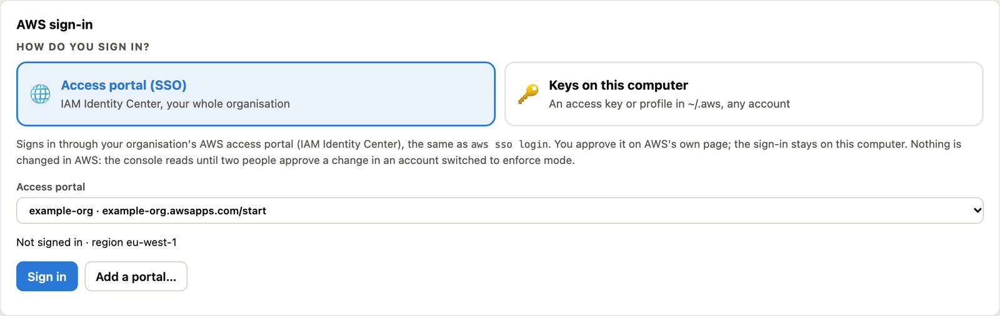
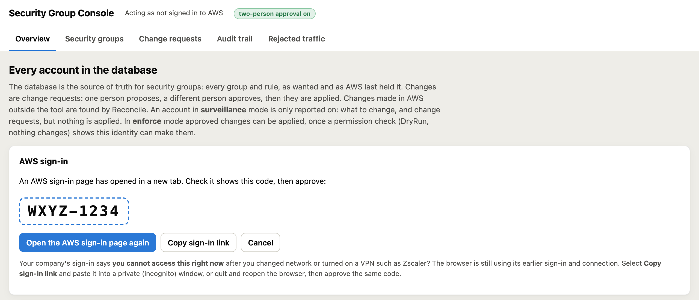
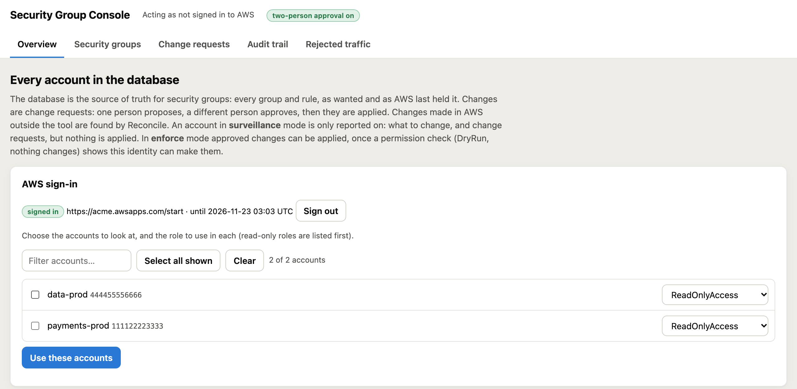
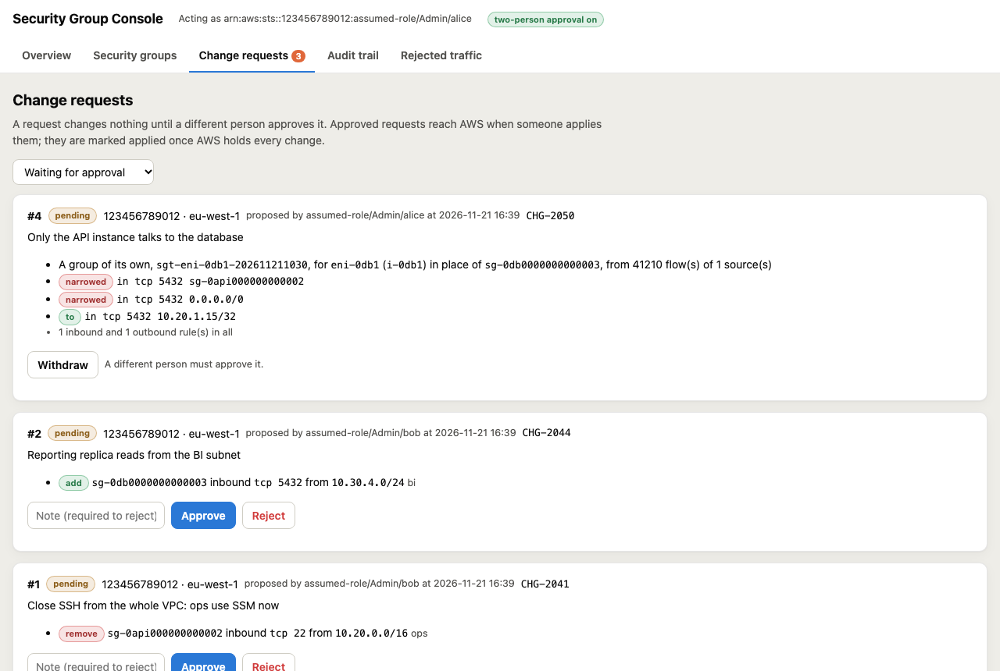
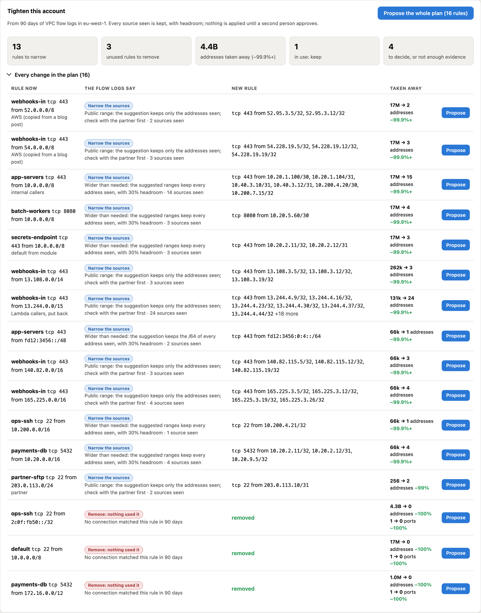
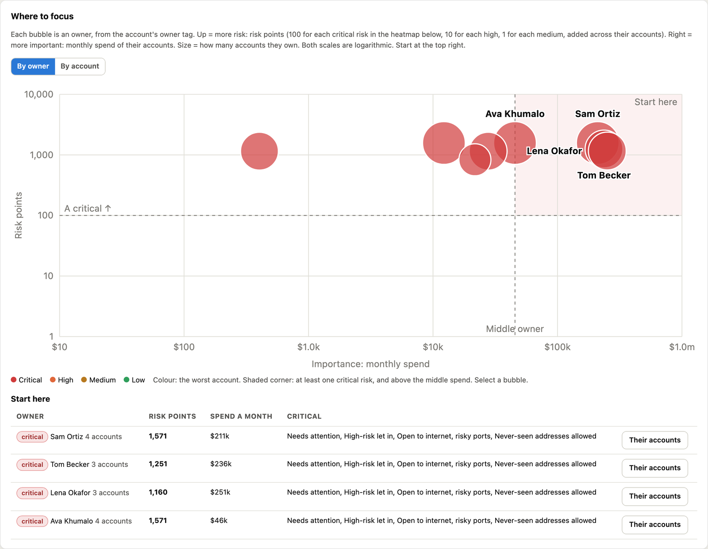
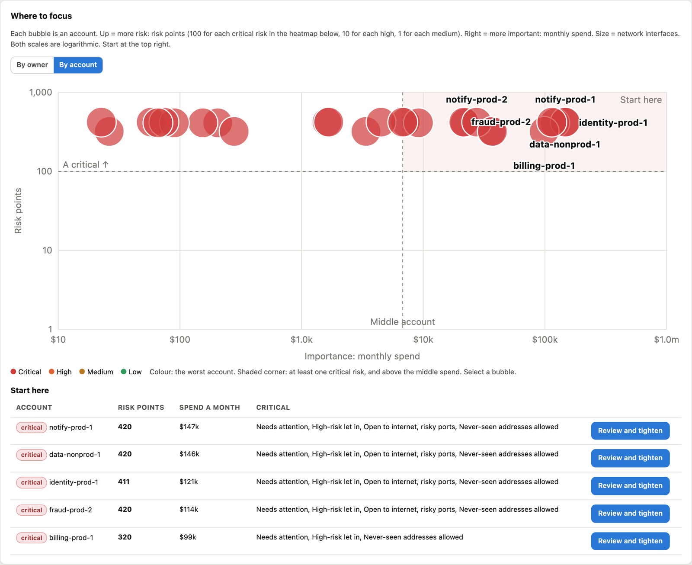
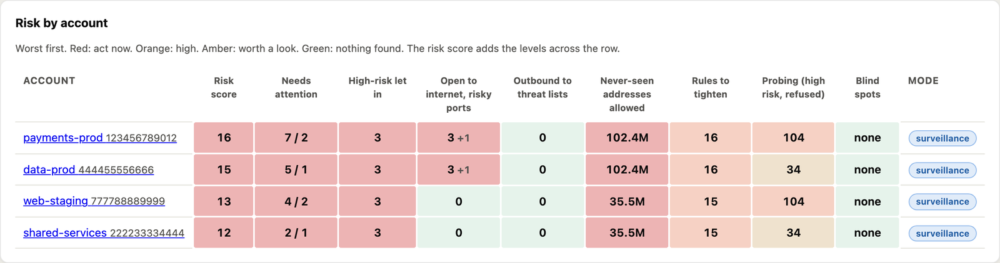
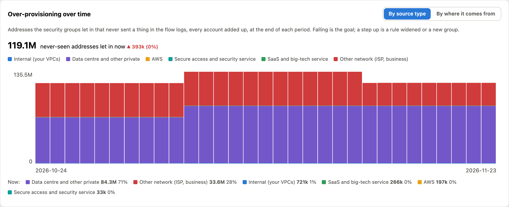

# The security group console (`sg_console.py`)

One local web page for every account in [the database](database.md): browse every security group and
rule, propose a change, approve or reject someone else's, apply approved changes, reconcile with AWS,
search the audit trail, and see every rejected flow across an OU.

```bash
python sg_console.py install     # always running: starts at login, restarts if it stops, opens the browser
python sg_console.py serve       # or just for now: opens http://127.0.0.1:8765/ (Ctrl-C stops it)
python sg_console.py open        # open it again later (same address every time: bookmark it)
python sg_console.py uninstall   # stop running in the background
```

The command line (`sg_db.py`) stays for scripts and cron; both work on the same database and the
same rules.

## Start here: sign in, choose an OU, read every account in it

No AWS CLI or command line is needed after the console is running.

1. **Sign in.** On the Overview, **AWS sign-in** asks how you sign in:
   - **Access portal (SSO)**: IAM Identity Center, your whole organisation. Pick the portal (every
     portal in `~/.aws/config` is listed; **Add a portal…** takes a new address and region) and
     **Sign in**. The AWS sign-in page opens in a new tab with a code; check it matches and approve. If
     you already ran `aws sso login` for the same portal, you are signed in straight away.
   - **Keys on this computer**: a profile or access key in `~/.aws`. Pick the profile and **Use this
     profile**. It acts as that identity in its own account and assumes one role you name in the others
     (`OrganizationAccountAccessRole` unless you choose another). The organisation's accounts and OUs are
     read with the profile, so use the management account or a delegated administrator to see them
     all; from any other account only its own account is offered.

   

   

   If your company's sign-in page says **you cannot access this right now** after you changed network
   or turned on a VPN such as Zscaler, the browser is reusing its earlier sign-in. **Copy sign-in
   link**, paste it into a private (incognito) window (or quit and reopen the browser) and approve the
   same code; **Open the AWS sign-in page again** reopens it in a normal tab.
2. **Choose one role and the accounts.** **Role in every account** is used in all of them (with SSO,
   the roles you have are looked up in a few accounts, read-only ones first; an account without the role
   is reported when it is read). Then choose accounts **By OU**: tick an OU (for example PROD) to choose
   every account in it and in the OUs under it; open an OU to see its accounts. The OUs are read with
   that role in the management account (SSO) or with the profile (keys), and kept for a day
   (**Reload the OUs** reads them again). **By account** lists every account with a filter instead.
   **Use these N accounts**.

   
3. **Read them all.** The role is shown once at the top, **Role in every account**: pick another and
   **Use this role in all accounts** switches every chosen account. Pick the regions (`all` reads every enabled region) and how far back (start with
   1 day), then **Read all N accounts**. Every account's security groups and network interfaces go into
   the console (free, 4 accounts at a time), and its flow logs are priced. Then one total: **Read flow
   logs for N accounts (about US$…)** spends it (CloudWatch Logs Insights, about US$0.005 a GB
   scanned), **Not now** does not. Accounts with nothing to read, or that could not be read (no access
   with the role, for example), are counted; **Show them** lists those that failed. A bar shows the
   progress, with the time left worked out from the pace so far; **Stop** stops it. **Each account** has
   the same, one account at a time.

   **Only accounts that spend.** By default only accounts that spent over **US$100 in the last 30 days**
   are read (change it next to **Read all**; 0 reads every one). The spend comes from Cost Explorer in the
   management account with your role (one call, about US$0.01, kept a day); without it each account is
   asked for its own, and an account whose spend cannot be read is read anyway. Skipped accounts are
   counted and say what they spent.

   **Groups on no interface are left out.** A security group attached to no network interface protects
   nothing: it is not counted on the Overview (each region says how many were left out), the review and
   over-provisioning ignore it, and the Security groups tab hides it unless **Show groups on no interface**
   is ticked.

   
4. **Look across them, then dive in.** **Risk overview** and **Over-provisioning** compare every account
   read, worst first; **Review and tighten** (or **Reduce**) opens one account's Security Group Review:
   the over-provisioning timeline, rejected traffic, and the Tighten panel, whose plan is proposed here
   as a change request.

Nothing is changed in AWS by any of this. Every account starts in **surveillance** mode; a change
reaches AWS only as a request a different person approves, in an account switched to enforce mode.

The SSO sign-in token (valid for the session length Identity Center sets, usually 8 to 12 hours) is kept
in `~/.sg-tightener/sso.json` (mode `0600`) so an always-running console survives a restart (with keys,
only the profile name, role and accounts chosen are kept, in `~/.sg-tightener/keys.json`); role
credentials are held only in memory and renewed as they expire. **Sign out** ends the session at
AWS. A role that can only read is enough to read; applying needs the
[write permissions](permissions.md).


## Always running

The **Always running** switch on the Overview (or `sg_console.py install`) keeps the console running
in the background, starts it when you log in and restarts it if it stops: a launchd agent on macOS
(`~/Library/LaunchAgents/com.sg-tightener.console.plist`), a systemd user service on Linux
(`~/.config/systemd/user/sg-console.service`). Turning it on from a console started by hand hands
over to the background copy at the same address; the page reloads by itself. Its log is
`~/.sg-tightener/console.log`. macOS does not let background programs read Desktop, Documents,
Downloads or iCloud Drive, so when sg-tightener lives there, turning it on copies the tool and the
packages it runs on (about 30 MB) to `~/.sg-tightener/app` and runs that copy; after updating
sg-tightener, turn Always running off and on again (or run `install` again) to refresh it. Proxy and CA bundle settings (`HTTPS_PROXY`, `AWS_CA_BUNDLE`, …) in
the environment it was turned on from are carried over. On Windows, start `sg_console.py serve` from
Task Scheduler at log on.

The address is always `http://127.0.0.1:8765/`: there is no token or password, because AWS SSO is the
sign-in that matters (see [Security model](#security-model) for what stops other web pages using it).
Old bookmarks ending in `?token=…` still work.


## The eight tabs

| Tab | What it shows and does |
|---|---|
| **Overview** | Every account and region: its **mode** (surveillance or enforce), groups, rules, assets, changes waiting to be applied, **whether this identity can apply there** (with a **Check** button: a DryRun of every write, nothing changes), when AWS was last read. The approvals mode, who you are acting as, and whether the audit trail's hash chain is intact. For an account `sg_review.py` has read, **Review and tighten** opens its Security Group Review (`/review?account=ID`), whose **Tighten** panel proposes the fitted rules here as a change request ([how](security-group-review.md#tighten-pull-the-room-back-by-kind-type-and-name)) |
| **Risk overview** | Every account `sg_review.py` has read, side by side: headline tiles, a risk heatmap, over-provisioning by owner and over time, internet exposure, high-risk sources let in, the biggest rules to tighten, and blind spots ([below](#risk-overview-every-account)) |
| **Over-provisioning** | For leaders: over-provisioned addresses by account and per asset, rated red, amber or green, led by a chart of over-provisioning over time by source type, with KPIs and **Remediate** for each account ([below](#over-provisioning-by-account-and-asset)) |
| **Remediate** | Pick an account and a look back: the account before and after, where its traffic comes from, the groups that change and the merges; untick anything sensitive and propose ([below](#remediate-an-account)) |
| **Security groups** | Tighten an account at a time. Pick an account and region: **Tighten this account** shows the plan from its flow logs (rules to narrow, unused rules to remove, addresses taken away) and **Propose the whole plan** sends it as one change request. Each group is one row, worst first, 50 to a page, with **Propose** for that group and **Details** for its rules: the rule now, what the flow logs say, the new rule and what it takes away. **Refresh from AWS** (read the groups, rules and interfaces again; changes made outside the tool go in the Audit trail), **Apply approved changes** (press twice; off in surveillance mode); **Propose a change by hand** and **Propose keeping what AWS holds** below. Then every **asset** (network interface) and its **History** of group changes |
| **Change requests** | Requests waiting for approval, approved, applied, rejected, withdrawn. Approve, or reject with a note, someone else's request; withdraw your own. Apply an approved one. An **asset request** (from `sg_db.py asset-propose`) shows the interface, the group it gets, the rules narrowed and why, and once approved **Create the group and move** the interface |
| **Audit trail** | Every entry, newest first, searchable (who, why, ticket, group, rule) and filtered by time and origin. Changes made outside the tool are red, with who made them from CloudTrail |
| **Rejected traffic** | A line chart of the distinct addresses refused over time, one line per kind of source, then every source the security groups and network ACLs refused, in every account `sg_review.py` has read, worst verdict first. Each source is marked **internal** or **external**, **IPv6**, **scanning**, and **new** (first seen in the last 7 days, never before in at least 14 days of flow logs), with when it was first seen. Filter by account, severity, risky ports, new addresses only, internal / external / IPv6 / scanning, and text. **Propose allowing** opens the change form with the source, port and a reason filled in |




## Remediate an account

The **Remediate** tab is the whole job for one account, for someone who should not have to do the maths:

1. **Pick an account and a look back** (1 month, **3 months** by default, 6 months, 1 year). Accounts without flow
   logs are hidden by default; the page says how many have none (turn on VPC flow logs to CloudWatch Logs) and how
   many have not been read (read them on the Overview: How far back is 30 days by default). With fewer days read than the look back, it says so and
   offers to read them.
2. **Read the summary.** The account **before and after**: security groups, IPv4 addresses let in, ports open, and
   how many rules are narrowed, removed as unused and merged. Rules open to everyone are left for a person to decide
   and not counted. Beside it, **where the traffic comes from**: your VPCs, data centre / on-prem, AWS, SaaS and
   partners, other internet, as a share of the connections let in.
3. **Look closer if you want.** The groups that change are behind one click: each with its interfaces, IPv4
   addresses before and after, its own traffic mix, and **Old and new rules** (the rule now, what the flow logs say,
   the new rule, what it takes away).
4. **Merges are proposed by default.** Groups in the same VPC with the same outbound rules that, once tightened,
   let in nearly the same traffic become one: each member may take on at most 256 more private addresses on the
   ports it has, or one more port (never a risky one) from sources it already lets in, and never a public address or
   everyone. The group on the most interfaces is kept; the others' interfaces move onto it and the emptied groups
   stay, on no interface, to delete later. Interfaces in auto scaling groups, EKS, ECS or managed by AWS are never
   moved, so their groups are never merged.
5. **Untick anything sensitive** (a group, or a merge) and **Propose this remediation**. That makes one rule change
   request per region and one merge request per merge, with the reasons written for you. The approver only approves.
6. **Apply** the rule changes, then **Move N interfaces onto ...** on each merge (Change requests). Each move is
   recorded and can be undone from the interface's History.
7. **If something breaks**, it is refused: it shows on **Rejected traffic**, where **Propose allowing** opens it up
   again for just that source and port.


## Tighten an account: the plan

The **Security groups** tab is built to tighten an account at a time, not a rule at a time. For the account and
region chosen, the flow logs `sg_review.py` read decide what each inbound rule should become:

| The flow logs say | New rule |
|---|---|
| **Narrow the sources** | the ranges that cover every source seen, with 30% headroom, inside the old range |
| **Narrow the ports** | a port range cut to the ports used (replies to the account's own connections stay one range) |
| **Remove: nothing used it** | none: the rule goes |
| **Keep**, **Open to everyone: decide**, **Not enough evidence yet** | unchanged: a person decides, or read more days |

Each change shows the **rule now**, the **new rule**, and what it takes away: addresses (16.8M → 4, −99.9%) and
ports (65,536 → 2). **Propose the whole plan** puts every change into one change request (remove the old rule, add
the new ones), with the reason written for you; **Propose** on a group or a rule sends just that. Nothing changes
in AWS until a second person approves and someone applies it. Groups are listed worst first, 50 to a page;
**Details** opens a group's rules only when you want to look closer.




Every long table in the console (accounts, groups, assets, audit trail, rejected traffic, risk by account) is
split into pages of 50 rows.

## Surveillance and enforce

An account in **surveillance** mode (the default) is reported on and requests are recorded, but
nothing is applied: the Security groups tab says so and Apply is off. When the organisation is ready,
press **Check** on the Overview (or `sg_db.py check`), then
`sg_db.py mode enforce --account ID --reason "…"`. Setting the mode is deliberately a command, not a
button: it is the decision to let the tool change AWS.

## Two-person approval

Approval is on by default. A change is a **request**: proposed with a reason (and a ticket), approved
by a **different person**, then applied. Proposal, approval, rejection and apply are each an entry in
the audit trail.

1. Alice proposes: in the console, or `sg_db.py add|remove|exec|adopt` or `sg_db.py propose --plan plan.json`.
2. Bob approves (`sg_db.py approve 12` or the console). The request's changes become *desired*.
   Alice cannot approve her own request; rejecting needs a note saying why.
3. Anyone applies (`sg_db.py apply --region R` or the console). The request is marked applied once AWS
   holds every change.

"A different person" means a different AWS principal: the role session name for an assumed role
(`AWSReservedSSO_Admin_…/alice` and `…/bob` differ), the user name for an IAM user.

While approval is on, `sg_tightener apply` and `sg_compact apply` refuse and say to propose the plan
instead (`sg_db.py propose --plan plan.json --reason "…"`). `sg_extend` (break-glass) and `revert`
still go through, flagged in the audit trail, so an outage is never waiting for a second person.

One person running a lab can turn it off: `sg_db.py approvals off --reason "single operator"`
(audited). Requests are then approved by the proposer at once.

## Who you are

Signed in with AWS SSO on the page, the console acts as that sign-in, with the role chosen for each
account. Otherwise it acts as the AWS identity it runs as (`--profile`, `AWS_PROFILE`), read again for
every change, exactly like `sg_db.py`. To approve, the second person runs their own console (or
`sg_db.py approve`) with **their** credentials against the **same database file**: run sg-tightener
on one shared host (a bastion or a container with a volume), each person signing in with their own
SSO profile.

To apply or reconcile in another account, the console assumes `--role-name` (default
`OrganizationAccountAccessRole`) there, as `sg_db.py --ou-id` does.

## Security model

- **Localhost only.** It listens on `127.0.0.1`. To reach it from a laptop, use an SSH tunnel
  (`ssh -L 8765:127.0.0.1:8765 bastion`), never a public bind.
- **No sign-in of its own.** AWS SSO (or the profile it runs as) is the sign-in; the page opens at
  `http://127.0.0.1:8765/` with no token. Anyone who can use your login on this computer can use it, as
  they could your `~/.aws` credentials, so don't run it on a computer other people log in to.
- **No cross-site changes.** Every change (POST) needs a key that only the console's own page holds,
  in an `X-SG-Token` header, and a JSON body; another web page can send neither and cannot read the
  page to learn the key. The key is kept in `~/.sg-tightener/console-token` (`0600`) so an open page
  keeps working across restarts; `serve --new-token` replaces it.
- **No cross-site reads.** Requests to `/api/` that the browser marks as coming from another site
  (`Sec-Fetch-Site`) or with a foreign `Origin` are refused, and no response allows cross-origin reads.
- **No DNS rebinding.** Requests whose `Host` is not `127.0.0.1:PORT` or `localhost:PORT` are refused.
- **Content Security Policy.** Only the page's own script runs (`script-src 'nonce-…'`), it can only
  talk to the console (`connect-src 'self'`), and it cannot be framed. Every value shown is escaped.
  The review page served at `/review` gets the same nonce on its scripts and loads nothing from
  outside.
- **The database is the boundary.** The console adds no privileges: AWS still decides what the
  identity may do, and the database still refuses a self-approval. The database file is `0600` in a
  `0700` directory.

## Risk overview: every account

The **Risk overview** tab answers "where is the risk, across everything?" from the reads `sg_review.py`
keeps for each account, for the chosen time window (24 hours to a year). Select an account name to
open its review.

- **Tiles**: accounts read, critical items to act on, high-risk sources let in, rules open to the
  internet on risky ports, outbound calls to threat lists, never-seen addresses allowed in, rules to
  tighten or remove, and high-risk sources probing (refused).
- **Where to focus**: a bubble chart, **By owner** or **By account**. Up = more risk: **risk points**
  (100 for each red dimension in the heatmap below, 10 for each orange, 1 for each amber, added across
  an owner's accounts), so one critical outweighs nine highs. Right = more important: the monthly
  spend (last 30 days, from Cost Explorer in the management account; without it, network interfaces).
  Size = accounts owned, or an account's interfaces. Colour = the worst account. Both scales are
  logarithmic. The shaded **Start here** corner holds those with a critical risk and above the middle
  spend; they are labelled, and listed under the chart worst first with **Review and tighten** (an
  account) or **Their accounts** (an owner). Select a bubble to list it. The owner is the account's
  Organizations tag (`Owner`, `AccountOwner`, `BusinessOwner`, `OwnerName`, `OwnerEmail`,
  `TechnicalOwner`, `ProductOwner`, `TeamOwner`, `Contact` or `Team`, the first found); accounts
  without one are drawn as "No owner tag". Tags are looked up in the background with the role in the
  management account and kept a day.

  

  
- **Risk by account**: a heatmap, one row per account, worst first. Each of eight dimensions is
  green (nothing found), amber (worth a look), orange (high) or red (act now); the **risk score** adds
  the levels across the row. The dimensions are needs attention (critical / high), high-risk sources
  let in, open to the internet on risky ports (and other open rules), outbound to threat lists,
  never-seen addresses allowed, rules to tighten, high-risk probing, and blind spots.



- **Over-provisioned by owner**: the addresses the rules let in today that were never seen in the flow
  logs, split by who owns them: internal (your VPCs), data centre and other private space, AWS, SaaS
  and partners, and other networks. **By source type** splits by secure access, SaaS and big tech, and
  ISP and business instead. **Share** shows each account as 100% to compare the mix. Pull back the
  biggest owner first: unused private space and whole provider ranges are usually most of it.


- **Over time**: never-seen addresses allowed, summed across accounts (each tightening is a step
  down), and high-risk probing per period (a jump means someone is looking).
- **Open to the internet, by port class**, with every rule open to `0.0.0.0/0` or `::/0` on a risky
  port; **high-risk sources let in** (scanners, threat lists, Tor exits a rule allowed); the **biggest
  rules to tighten** across accounts; and **blind spots**: coverage under 98% of the window, groups
  without flow logs, under 7 days of evidence, and accounts in the console never read.


The same data is at `GET /api/macro?range=1m` (`24h`, `1w`, `1m`, `3m`, `6m`, `1y`).

## Over-provisioning: by account and asset

It opens with **over-provisioning over time**: the addresses let in that never sent anything, every account added
up, at the end of each period, by **source type** or by **where it comes from**, with the total now and its change.
It needs flow logs: accounts read for their groups only are counted and the page says how to read their flow logs.



The **Over-provisioning** tab is the leaders' view: how much each account lets in that nobody uses,
which assets carry it, and whether it is coming down.

**Over-exposure per asset** is, for one network interface, the number of addresses its security groups
(all of them together) let reach it that were never seen in the flow logs. IPv4; a rule open to the
whole internet is not counted in the number (it would swamp it) but is shown, and makes the asset red
on a risky port.

| Rating | Over-exposure of the asset |
|---|---|
| **Green** (right-sized) | up to 256 never-seen addresses, a /24 |
| **Amber** | up to 65,536, a /16 |
| **Red** | more than 65,536, or open to the internet on a remote admin, database, Windows or container port |

An account is red if any of its assets is red, amber if any is amber, green otherwise. Assets whose
groups have no flow logs are not rated (they are counted as not logged).

**KPIs**: never-seen addresses allowed in across every account and the change over the window; assets
right-sized (the share rated green) against a **90% target**; red and amber assets and their change;
average over-exposure per asset and the worst asset; accounts green; assets left to fix to reach the
target; rules to tighten or remove.


- **Assets by rating over time**: red, amber and green assets at the end of each period, across every
  account. Red shrinking and green growing is the goal.
- **By account**, worst first: rating, the red/amber/green split, right-sized share against the target,
  over-provisioned now, change in the window with a trend line, average per asset, worst asset, and
  **Reduce**, which opens the account's review whose **Tighten** panel proposes the fitted rules for
  two-person approval.


- **Biggest wins**: the rules that would fix the most, ranked by never-seen addresses times the assets
  the rule reaches.
- **Every asset**: rating, asset (name, kind, interface, region, public IP), groups, over-exposure,
  change in the window, and risky ports open to the internet; filter by account, rating and text.


## Rejected traffic across an OU

The **Rejected traffic** tab reads what `sg_review.py` keeps for each account in
`~/.sg-tightener/review/`. Fill it for a whole OU and keep it fresh:

```bash
python sg_review.py org   --regions eu-west-1 --ou-id ou-ab12-cdef3456 --days 7 --yes
python sg_review.py watch --regions eu-west-1 --ou-id ou-ab12-cdef3456 --slack https://hooks.slack.com/… --loop
```

`watch --ou-id` reads every account each loop (every 5 minutes, up to five minutes ago) and alerts on
rejected traffic that needs attention; an account whose role cannot be assumed is logged and the rest
carry on. The same table is on the org page (`sg-review-org/index.html`, **All rejected traffic**).

## Flags

| Flag | Default | Meaning |
|---|---|---|
| `--port` | `8765` | Port on 127.0.0.1 |
| `--db` | `$SG_TIGHTENER_DB` or `~/.sg-tightener/sg.db` | The database |
| `--profile` | the usual credential chain | AWS profile, for example an SSO one |
| `--role-name`, `--external-id` | `OrganizationAccountAccessRole` | Role assumed in other accounts to apply and reconcile (not used when signed in with SSO on the page) |
| `--new-token` | off | Make a new page key (pages already open must be reloaded) |
| `--no-browser` | off | Do not open the browser at start |
| `--data-dir` | `~/.sg-tightener` | Where `sg_review` keeps what it read |
