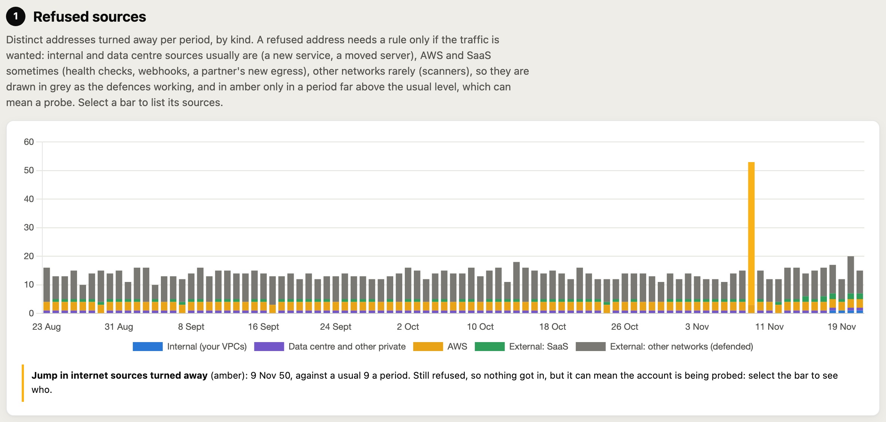
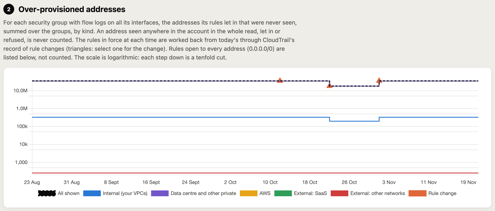
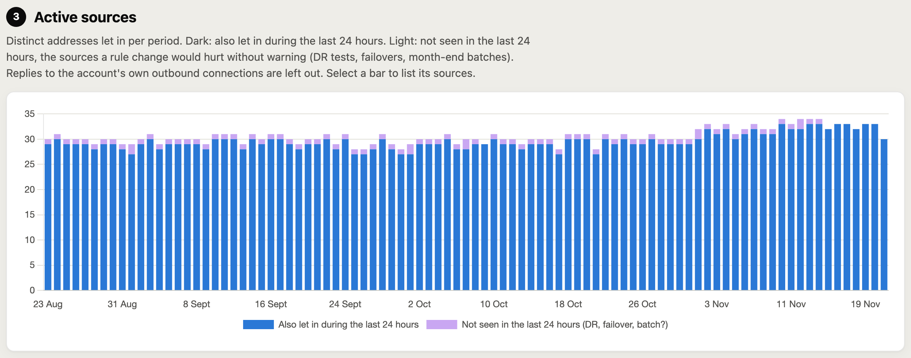
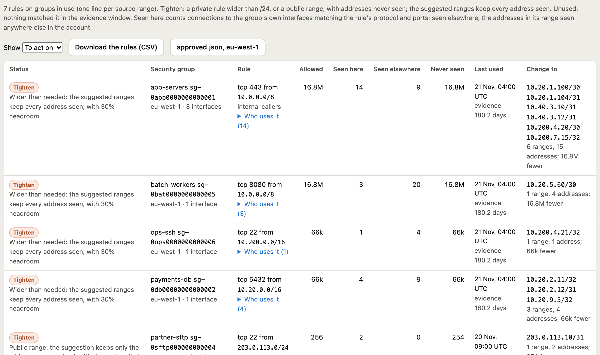

# Security Group Review (`sg_review.py`)

`sg_review.py` sets every inbound security group rule in one account against the traffic the
account's VPC flow logs carried. It writes the result as **one self-contained HTML page** with three
timelines and a table of what to change. The page needs no server and no sign-in: open it in any
browser, offline, or attach it to a change request.

It is read-only. It uses your normal AWS credentials (`aws sso login`, a `--profile`, or the
environment), not a login of its own.


*Every image on this page comes from `python sg_review.py demo`, a made-up account, set to 3 months.*

---

## Making the graphs in three commands

```bash
# 1. Read one day first. It measures how many bytes of flow log the account writes per second,
#    so that longer reads can be costed before you pay for them.
python sg_review.py read --regions eu-west-1 --days 1

# 2. Read further back. Only time not already read is read. You see the estimated cost and
#    type "yes" to go ahead.
python sg_review.py read --regions eu-west-1 --days 90

# 3. Write the page. This makes no AWS call.
python sg_review.py report --onprem "10.200.0.0/16 Johannesburg DC" \
                           --internal "10.40.0.0/16 Payments prod"
# -> sg-review-<account>.html
```

To see the page without AWS access:

```bash
python sg_review.py demo            # -> sg-review-demo.html
```

---

## The parameters, and what each one changes on the page

### `read`: what the graphs can show

| Parameter | Values | Effect on the graphs |
|---|---|---|
| `--regions` | `eu-west-1,us-east-1` | Which regions' security groups and flow logs are read. All regions appear on one page, and approved.json downloads are per region |
| `--days` | `1`, `7`, `30`, `90`, `180` (default `1`) | How far back is read. It decides which **Timeline** buttons work: `1` gives 24 hours; `7` adds 1 week; `30` adds 1 month; `90` adds 3 months; `180` adds 6 months. Buttons for ranges not read are greyed out. Rules are only called *unused* or *Tighten* after 30 days of evidence |
| `--profile` | an AWS profile | The credentials to read with. The account is whichever one those credentials belong to |
| `--name` | text | The account name shown in the header (default: the account alias) |
| `--yes` | flag | Skip typing `yes` after the cost estimate, for scheduled runs |

You can run `read` again at any time. Only the gap since the last read is read, so a daily run
costs one day of Logs Insights. Logs Insights costs about US$0.005 per GB scanned. Press Ctrl-C to
stop a read; the slices already read are kept.

### `report`: how sources are named and coloured

| Parameter | Example | Effect on the graphs |
|---|---|---|
| `--onprem` | `"10.200.0.0/16 Johannesburg DC, 10.201.0.0/16 Cape Town DC"` | These ranges count as **Data centre** (purple) and are labelled with your name for them. Ranges behind the account's VPN connections are added automatically |
| `--internal` | `"10.40.0.0/16 Payments prod"` | Your other accounts' ranges count as **Internal** (blue), the same as the account's own VPCs |
| `--offline` | flag | Do not refresh the public lists that name AWS services, SaaS providers and AS numbers. A few well-known ranges are used instead, and the page says so |
| `--account` | `123456789012` | Which account's read to report, if you have read more than one |
| `--out` | `review.html` | Output file (default `sg-review-<account>.html`) |

Ranges are separated by commas. Each one is a CIDR, then a space, then a name.

### Other commands

| Command | What it does |
|---|---|
| `approved --region R [--account ID] [--out approved.json]` | Writes sg-tightener's `approved.json` from the review, ready for `sg_tightener.py plan`. The same file can be downloaded from the page |
| `demo [--offline] [--out FILE]` | The page for a made-up account |
| `forget --account ID` | Deletes what was read for that account |
| `--data-dir DIR` (before the command) | Where reads and address lists are kept (default `~/.sg-tightener`) |

---

## On the page

The **Timeline** buttons switch the graphs between 24 hours (hourly bars), 1 week (6-hour bars),
and 1, 3 or 6 months (daily bars). The **Show** chips switch each kind of source on or off in all
three graphs and tables. The kinds are internal, data centre, AWS, SaaS and other networks.

### 1. Refused sources



These are distinct addresses turned away in each period. A refused address needs a rule only if
the traffic is wanted:

- **Internal and data centre** sources usually are wanted, for example a new service or a moved server.
- **Other networks** are drawn in grey: this is the defences working.
- A period with more than five times the usual number of refused internet sources (and at least 20)
  turns amber and is named under the graph, because it can mean the account is being probed.

Select a bar to list who was refused. The table below the graph suggests a rule for internal and
data centre sources.

### 2. Over-provisioned addresses



This graph counts addresses the rules let in that were **never seen anywhere in the account**. It
is summed over every security group that has flow logs on all its interfaces.

- The rules in force on each day are worked back from today's rules using CloudTrail's record of
  rule changes. Each triangle is a change; select one to see it.
- Rules open to `0.0.0.0/0` are listed in the rules table and not counted here.
- The scale is logarithmic, so each step down is a tenfold cut.

### 3. Active sources



These are distinct addresses let in during each period.

- **Dark** bars are sources that were also seen in the last 24 hours.
- **Light** bars are sources not seen in the last 24 hours. These are the ones a rule change would
  break without warning: DR tests, failovers and month-end batches.

Replies to the account's own outbound connections are left out.

### The rules table



Each rule gets one of these statuses:

- **Tighten**: a private rule wider than /24, or a public range, with addresses never seen. The
  suggested ranges come from sg-tightener's fitting and keep every address seen, with headroom.
- **Unused**: nothing matched the rule in the evidence window.
- **Open to all**
- **In use**
- **Not logged**: some of the group's interfaces have no flow log.

Use **Download the rules (CSV)** to share the table. Use **approved.json, &lt;region&gt;** to take
the suggestions straight into the usual sg-tightener flow:

```bash
python sg_tightener.py plan --region eu-west-1 --approved approved.json --out plan.json
```

---

## Where things are kept

| Path | Contents |
|---|---|
| `~/.sg-tightener/review/<account>.json.gz` | What was read: flow-log slices, security groups, interfaces, VPCs, rule changes. Mode 0600 in a 0700 directory |
| `~/.sg-tightener/ipintel/` | The public address lists (AWS, SaaS providers, AS numbers), refreshed daily (AS numbers weekly) |
| `sg-review-<account>.html` | The page. It describes your network, so treat it as confidential |

The permissions needed are in [permissions.md](permissions.md). Every flag is in the
[CLI reference](cli-reference.md#sg_reviewpy).
