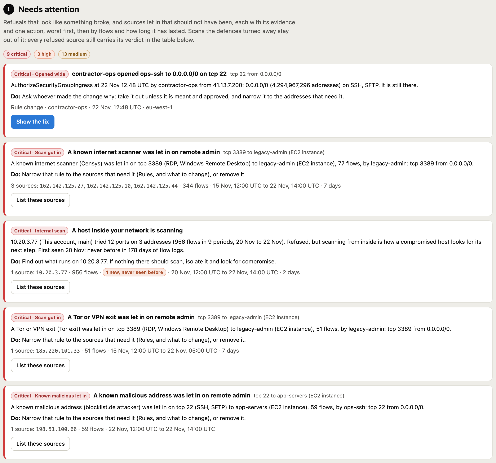
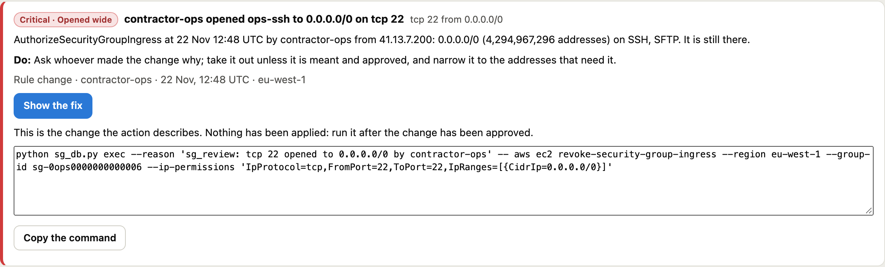
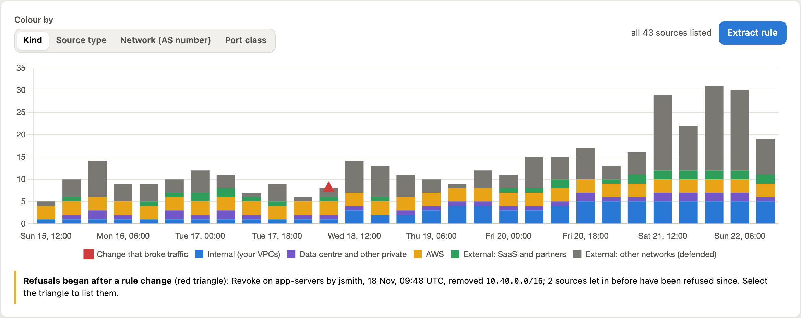
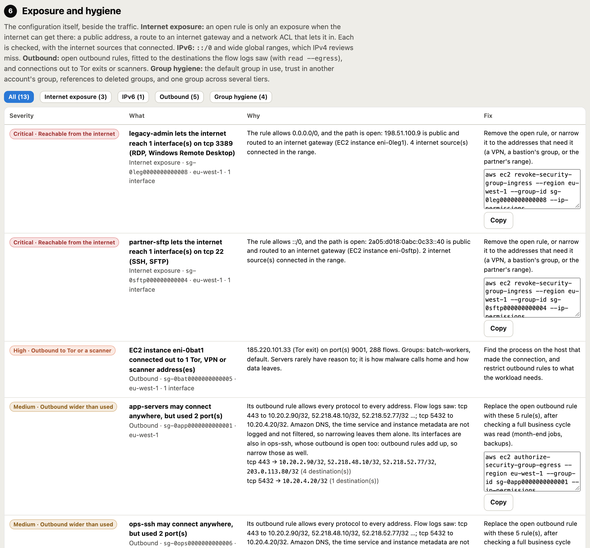
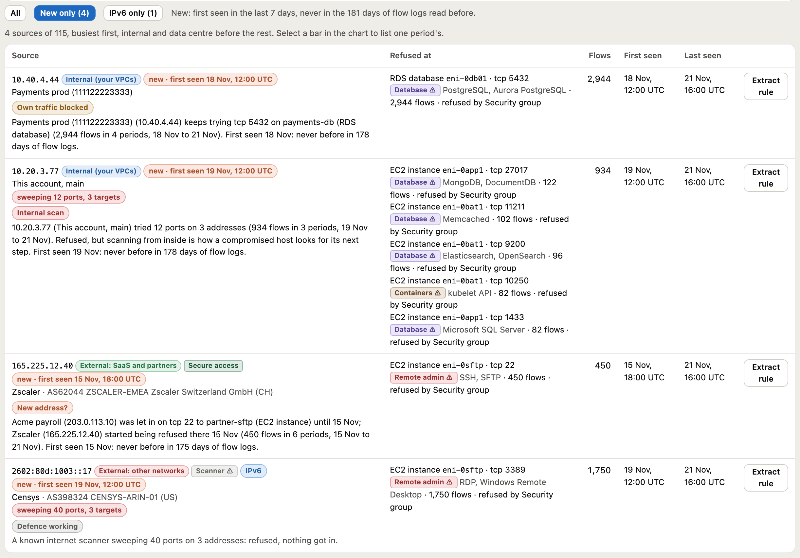
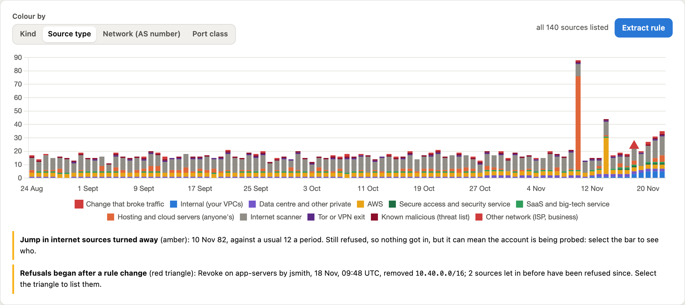
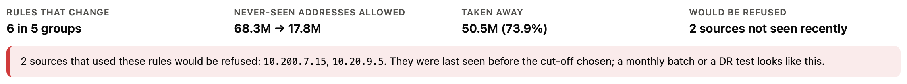
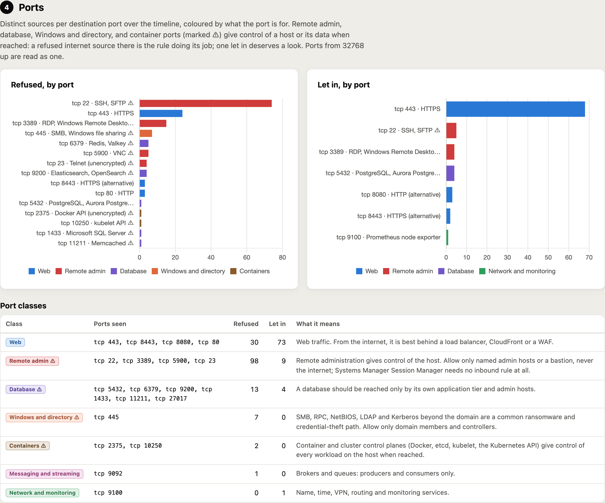

# Security Group Review (`sg_review.py`)

> **Why this exists.** Security groups written once and frozen in Terraform end up letting in whole
> corporate or data centre blocks (`10.0.0.0/8` is 16.7 million addresses) because nobody knows who
> really calls each service. With attackers working from any one compromised host inside the
> network, trusting a whole CIDR block is a high-risk strategy. sg-tightener treats every allowed
> IP address as risk: it takes security group sources out of static configuration and, from VPC flow
> log evidence, fits each group's limited rules to the fewest addresses that cover the real callers.
> See [The shift: IP addresses are risk, not configuration](../README.md#the-shift-ip-addresses-are-risk-not-configuration).

`sg_review.py` sets every inbound security group rule in one account against the traffic the
account's VPC flow logs carried. It writes the result as **one self-contained HTML page** with three
timelines and a table of what to change. The page needs no server and no sign-in: open it in any
browser, offline, or attach it to a change request.

It is read-only. It uses your normal AWS credentials (`aws sso login`, a `--profile`, or the
environment), not a login of its own.


*Every image on this page comes from `python sg_review.py demo`, a made-up account, set to 3 months.*

---

## Making the graphs in three commands

```bash
# 1. Read one day first. It measures how many bytes of flow log the account writes per second,
#    so that longer reads can be costed before you pay for them.
python sg_review.py read --regions eu-west-1 --days 1

# 2. Read further back. Only time not already read is read. You see the estimated cost and
#    type "yes" to go ahead.
python sg_review.py read --regions eu-west-1 --days 90

# 3. Write the page. This makes no AWS call.
python sg_review.py report --onprem "10.200.0.0/16 Johannesburg DC" \
                           --internal "10.40.0.0/16 Payments prod"
# -> sg-review-<account>.html
```

To see the page without AWS access:

```bash
python sg_review.py demo            # -> sg-review-demo.html
```

---

## The parameters, and what each one changes on the page

### `read`: what the graphs can show

| Parameter | Values | Effect on the graphs |
|---|---|---|
| `--regions` | `eu-west-1,us-east-1` | Which regions' security groups and flow logs are read. All regions appear on one page, and approved.json downloads are per region |
| `--days` | `1`, `7`, `30`, `90`, `180` (default `1`) | How far back is read. It decides which **Timeline** buttons work: `1` gives 24 hours; `7` adds 1 week; `30` adds 1 month; `90` adds 3 months; `180` adds 6 months. Buttons for ranges not read are greyed out. Rules are only called *unused* or *Tighten* after 30 days of evidence |
| `--profile` | an AWS profile | The credentials to read with. The account is whichever one those credentials belong to |
| `--name` | text | The account name shown in the header (default: the account alias) |
| `--egress` | flag | Also read outbound connections: fills the outbound findings in [Exposure and hygiene](#exposure-and-hygiene). About half as much again per read; stays on for the account |
| `--yes` | flag | Skip typing `yes` after the cost estimate, for scheduled runs |

You can run `read` again at any time. Only the gap since the last read is read, so a daily run
costs one day of Logs Insights. Logs Insights costs about US$0.005 per GB scanned. Press Ctrl-C to
stop a read; the slices already read are kept.

### `report`: how sources are named and coloured

| Parameter | Example | Effect on the graphs |
|---|---|---|
| `--onprem` | `"10.200.0.0/16 Johannesburg DC, 10.201.0.0/16 Cape Town DC"` | These ranges count as **Data centre** (purple) and are labelled with your name for them. Ranges behind the account's VPN connections are added automatically |
| `--internal` | `"10.40.0.0/16 Payments prod"` | Your other accounts' ranges count as **Internal** (blue), the same as the account's own VPCs |
| `--names` | `partners.yaml` | Names partners and other networks you know, by range or AS number (see [Your names file](#your-names-file)). Default `~/.sg-tightener/names.yaml` if it exists |
| `--offline` | flag | Do not refresh the public lists that name AWS services, SaaS providers, AS numbers and Tor exits. A few well-known ranges are used instead, and the page says so |
| `--account` | `123456789012` | Which account's read to report, if you have read more than one |
| `--out` | `review.html` | Output file (default `sg-review-<account>.html`) |

Ranges are separated by commas. Each one is a CIDR, then a space, then a name.

### Other commands

| Command | What it does |
|---|---|
| `approved --region R [--account ID] [--out approved.json]` | Writes sg-tightener's `approved.json` from the review, ready for `sg_tightener.py plan`. The same file can be downloaded from the page |
| `demo [--offline] [--out FILE]` | The page for a made-up account |
| `names [--out FILE]` | Checks the names file and lists what it names, or writes an example one if there is none |
| `reach ADDRESS [--account ID] [--json]` | Blast radius: every rule that admits the address, worst first, with the interfaces behind each group. See [Blast radius](#blast-radius-what-can-one-address-reach) |
| `forget --account ID` | Deletes what was read for that account |
| `watch --regions R [--slack URL] [--email-to A]` | Alert mode: reads only the newest flow logs and posts the new **Needs attention** items. See [Alert mode](#alert-mode-watch) |
| `org --regions R [--ou-id OU] [--role-name ROLE]` | Reads every account in an OU and writes a roll-up of what needs attention in each. See [Every account in an OU](#every-account-in-an-ou-org) |
| `--data-dir DIR` (before the command) | Where reads and address lists are kept (default `~/.sg-tightener`) |

---

## On the page

The **Timeline** buttons switch the graphs between 24 hours (hourly bars), 1 week (6-hour bars),
and 1, 3 or 6 months (daily bars). The **Show** chips switch each kind of source on or off in every
graph and table. The kinds are internal, data centre, AWS, SaaS and other networks.

### Needs attention



The first box on the page lists what looks wrong, worst first, then by flows times how long it has
lasted. Each item has a severity, what was seen, the evidence and one action. **List these sources**
filters the table below to them, and **Extract rule** opens the dialog for them.

Every refused source gets a verdict from what was already read: flows, CloudTrail rule history, network
ACLs, attribution and your names file. No extra AWS call is made. The first match wins:

| Verdict | Severity | When |
|---|---|---|
| Internal scan | Critical | A host in your VPCs or data centre sweeps many ports or targets. Refused, but that is how a compromised host looks for its next step |
| Scan | Info | An internet source sweeps many ports or targets and is refused: the defences working. Never listed in the box |
| Fixed since | Info | Refused earlier in the range, nothing since |
| Broken by a change | High | Let in before, refused right after a CloudTrail rule change on that group. The item names who made the change and offers **Restore the revoked rule** |
| Stopped working | High | Let in before, refused since, no change found |
| Network ACL | Medium | A network ACL refused it first: change the ACL, not the security group |
| New address? | High | Another source of the same client was let in on that interface and port, and stopped within two days of this one being refused (a partner moving to Zscaler, say) |
| Same provider | Medium | The provider is let in elsewhere in the account |
| Health check refused | Medium | AWS health checkers (Route 53, ELB) are refused, so the target looks down |
| Own traffic blocked | Medium | Your own internal or data centre traffic keeps trying |
| Partner refused | High | A partner in your names file is refused |
| Service refused | Medium | A known SaaS service keeps trying (webhooks, integrations) over two or more periods |
| Retrying | Low | Anything else that keeps trying |
| Refused | Info | The rest |

Sources **let in** are checked as well. A known scanner or Tor exit let in on a risky port (remote
admin, database, Windows, containers) is **critical**, and high on any other non-web port. A hosting
provider let in on a risky port is high. These mean a rule is too open, usually `0.0.0.0/0`: the item
names the rule.



When a rule change caused refusals, a red triangle on the refused graph marks it. Select the triangle
to list the sources it cut off.



**Rules opened wide.** A rule added in the last 24 hours (from CloudTrail: `AuthorizeSecurityGroupIngress`
and `ModifySecurityGroupRules`) that lets in a wide range becomes an item at once, before any traffic
uses it, naming who added it, from which address, and when:

| Added | Severity |
|---|---|
| `0.0.0.0/0` or `::/0` on a risky port (remote admin, database, Windows, containers) | Critical |
| `0.0.0.0/0` or `::/0` on another non-web port | High |
| `0.0.0.0/0` or `::/0` on 80 or 443 | Medium |
| A public `/16` or wider (IPv6 `/32` or wider) | High on a risky port, medium otherwise |
| A private `/8` on a risky port | Medium |
| Any of these, already removed again | Low |

The item gives the `revoke-security-group-ingress` command (by rule id when CloudTrail recorded it),
run through the security group database (`sg_db.py exec`). These items are in the report and in
`watch --alerts all`. A rule changed outside sg-tightener is also found, for every change and not only
wide ones, by `sg_db.py reconcile` ([the database](database.md)).

### PrivateLink


Both sides of PrivateLink are checked, from the same read:

| Finding | Severity | When | The fix it gives |
|---|---|---|---|
| PrivateLink open to all | Critical, or high when each connection must be accepted | An endpoint service this account provides allows principal `*`: any AWS account can create an endpoint to it | `modify-vpc-endpoint-service-permissions` removing `*` and adding the accounts connected today, and `--acceptance-required` |
| Accepted automatically | Low | Named principals, but each new endpoint is accepted without review | `--acceptance-required` |
| PrivateLink not filtered | Medium | The load balancer behind the service has no security group, or does not apply its groups to PrivateLink traffic | `elbv2 set-security-groups ... --enforce-security-group-inbound-rules-on-private-link-traffic on` (a load balancer created without a group must be recreated) |
| Endpoint too open | High for `0.0.0.0/0`, medium for a `/16` or wider | An interface endpoint's security group (Secrets Manager, STS, a partner's service) lets in a whole network | The callers flow logs saw, and the ranges from the rules table that cover them |

Critical, high and medium findings join **Needs attention**, so `watch` posts them and `org` counts
them. `sg_ou_report.py` makes the same provider checks across an organisation, and names security
group findings on an interface endpoint's groups as `SG (PrivateLink endpoint)`.

### Exposure and hygiene



The sixth section checks the configuration itself, whatever traffic flowed. Filter it by area:

| Area | Finding | Severity |
|---|---|---|
| Exposure | **Reachable from the internet**: a rule lets in `0.0.0.0/0` or `::/0` and at least one interface using the group has a public address, in a subnet routed to an internet gateway, with network ACLs that let the traffic in | Critical on a risky port or all traffic, high on another port, low on 80/443. A load balancer on a web port is left out |
| Exposure | **Open, not reachable today**: the same rule, but no interface is reachable (private subnets, no public address). One change away | Low |
| IPv6 | **Wide IPv6 range**: a global range of `/32` or wider (`::/0` is treated as `0.0.0.0/0` throughout) | Medium; low when no interface has an IPv6 address |
| Outbound | **Connected to Tor, a VPN or a scanner**: an interface connected out to one (needs `read --egress`) | High |
| Outbound | **Fit outbound rules**: a group may connect anywhere, but used a few destinations and ports. Gives the `authorize-security-group-egress` commands for what was used, then the revoke of the open rule. More than 10 public destinations on 80/443 keep `0.0.0.0/0` on those ports | Medium when 15 rules or fewer, low otherwise |
| Outbound | **Open outbound on a database** (no outbound data read) | Low |
| Hygiene | **Default group in use**: interfaces use a VPC's default security group (CIS AWS Foundations 5.4) | Medium |
| Hygiene | **Trusts another account**: a rule lets in a security group from another account (or through peering) | Medium |
| Hygiene | **Reference to a deleted group**: a stale rule from `DescribeStaleSecurityGroups` | Low |
| Hygiene | **Shared across tiers**: one group used by, say, both instances and a database | Low |
| Hygiene | **Unused open group**: a group open to the internet that no interface uses | Low |

Critical, high and medium findings join **Needs attention**. Outbound data costs about half as much
again per read, so it is off by default: `read --egress` turns it on for that account, and the next
`read` reads the slices it already has again with outbound added.

### Who each address is

Every source address is attributed, on the computer that writes the page, from these lists:

| Kind | How it is recognised | What the page shows |
|---|---|---|
| **Internal** | The account's own VPC ranges, and the ranges given with `--internal` | The VPC or your name for the range, and the range |
| **Data centre** | The ranges given with `--onprem`, the routes of the account's VPN connections, and any other private address | Your name for the range (for example "Johannesburg DC" or "Behind VPN …"), and the range |
| **AWS** | AWS's published `ip-ranges.json` | The AWS service and region (for example "Route 53 health checks, eu-west-1"), the published prefix, and the AS number |
| **SaaS** | Providers' published ranges (GitHub, Cloudflare, Google, Atlassian, Okta, Datadog, Fastly and others), then well-known provider AS numbers | The provider, the published prefix, and the AS number |
| **Other networks** | Everything else | The **AS number and owner**, the country, and the block that network announces |

**IPv6 sources** are attributed the same way, from the IPv6 ranges in the same lists: AWS's
`ipv6_prefixes`, Cloudflare's, Google's and the other providers' IPv6 ranges, iptoasn's IPv6 AS list
(`ip2asn-v6.tsv.gz`, read weekly) and the Tor Project's IPv6 exits. Inside means the VPCs' IPv6 blocks
and each interface's own IPv6 address; unique local (`fc00::/7`) and link-local (`fe80::/10`)
addresses are private, like `10.0.0.0/8`, so they count as data centre unless a VPN route,
`--internal`, `--onprem` or your names file says otherwise (each takes IPv6 ranges too). IPv6 sources
get the same verdicts, scan detection, port classes and network ACL checks (the ACL's IPv6 entries),
and an **IPv6** chip. A copy of the lists downloaded by an older version has no IPv6 ranges until its
daily refresh.

### New addresses: seen before or not



Every source carries the first time it appears in **anything the account's cache holds**, whatever
range the page shows, so the page can answer "have we seen this address before?":

- **new**: first seen in the last 7 days, after at least 14 days of flow logs read without it. With
  less history nothing is called new (the filter says how many days have been read).
- **seen before**: first seen before the range shown starts; the First seen column adds "seen before:
  first …".

Refused and active sources show a **new · first seen …** chip, and **New only** and **IPv6 only**
filters sit above each table. A verdict about a new source ends "First seen 15 Nov: never before in 85
days of flow logs", and a "New address?" verdict whose source was in fact seen weeks ago says "Not a
new address though". Needs attention items count their new sources, and so do `watch` alerts
("1 new (never seen before)").

### Source type: who is behind a provider's address

A SaaS or internet address is then given a **source type** from a built-in list of some 100 AS
numbers and 80 owner-name patterns (`ORG_ASNS` and `ORG_NAMES` in `sg_ipintel.py`), so the page can
say "Censys, internet scanner" rather than "AS398324":

| Source type | Kind | Examples | What it means for a rule |
|---|---|---|---|
| **CDN** | SaaS | Cloudflare, Akamai, Fastly, Imperva, Edgio | The addresses carry every customer's traffic: allowing them allows any site or worker on the CDN |
| **Secure access** | SaaS | Zscaler, Netskope, Palo Alto Prisma Access, Cato, Cisco Umbrella, Forcepoint, iboss, Mimecast, Proofpoint | Every customer's users leave from the same addresses: allowing them allows every customer of that service, not only your partner |
| **SaaS** | SaaS | GitHub, Atlassian, Slack, Okta, Datadog, Salesforce, Microsoft, Google, Stripe, Twilio | The provider's own service, such as a webhook or an integration |
| **Anyone's hosting** | Other networks | DigitalOcean, OVHcloud, Hetzner, Linode, Vultr, Contabo, Google Cloud and Oracle Cloud customers' servers | Anyone can rent a server there: the address says nothing about who is behind it |
| **Scanner** | Other networks | Shodan, Censys, Shadowserver, Rapid7, BinaryEdge, Onyphe, Driftnet | Scans the whole internet for open ports, and never needs a rule |
| **Tor or VPN** | Other networks | Every relay on the Tor Project's exit list (whatever network hosts it), Tor exit operators, Mullvad, NordVPN, Proton VPN, M247 | Whoever is behind it cannot be known |
| **Known malicious** | Other networks | Every address on a threat list (below), wherever it is hosted | Never needs a rule. Let in is critical on remote admin or databases; a connection **out** to one is critical |
| **Partner** | SaaS and partners | Whatever your names file calls a partner | Named by you: check the name still holds |
| **Other** | Other networks | Every other ISP or business network | |

A published range wins over the AS number. Over-provisioned "SaaS" addresses count only the
providers' own ranges and networks, not anyone's hosting. Microsoft's and Google's main AS numbers
also carry Azure and some Google Cloud services, so a source named "Microsoft" may still be a
customer's server.

### Known malicious addresses: Tor and the threat lists

Besides the Tor Project's exit list, every source and every outbound destination is checked against
four free threat lists, downloaded daily with the other lists (`threat.json` in the data directory)
and looked up locally, so no address leaves the machine:

| List | What is on it |
|---|---|
| [abuse.ch Feodo Tracker](https://feodotracker.abuse.ch/) | Botnet command and control servers |
| [Spamhaus DROP](https://www.spamhaus.org/blocklists/do-not-route-or-peer/) (IPv4 and IPv6) | Netblocks run by criminals or hijacked |
| [Proofpoint Emerging Threats](https://rules.emergingthreats.net/blockrules/) compromised IPs | Hosts known to be compromised |
| [blocklist.de](https://www.blocklist.de/) | Addresses reported attacking SSH, mail or web servers in the last 48 hours |

The first list that holds an address names it ("Feodo Tracker botnet C2"). A list wins over the AS
number and over AWS EC2 and cloud ranges (an attacker's rented server is still an attacker), but not
over a provider's own service: a Cloudflare or Google address on a list keeps its provider's name,
because it carries everyone's traffic.

What it changes on the page:

- **Refused**: "Known malicious address refused", info: the defences working.
- **Let in**: "Known malicious let in", **critical** on remote admin, databases and other risky
  ports, high on the rest (not on the public web, which anyone may reach). It is in Needs attention and
  in `watch` alerts.
- **Outbound** (`read --egress`): "Outbound to a known malicious address", **critical**: a server
  calling a botnet command server is how a compromised host looks.
- **Tighten**: known malicious sources, Tor exits and scanners are **turned away, not kept**, by
  default (source type **Turn away**), and listed under the panel.
- **Console**: Rejected traffic marks them **known malicious** or **Tor**, with a filter.

Your own threat intelligence goes in your names file with `type: threat`; it wins over the lists. In
the demo, an attacker on blocklist.de is refused on SSH for weeks, then let in two hours ago when a
contractor opened `ops-ssh` to the world; and an app server has been calling a Feodo botnet command
server since yesterday.

### Your names file

A names file puts your own names on networks the public lists cannot know: a partner's office, a
supplier's servers, the scanner your security team pays for. Entries name ranges, AS numbers or
both, and win over every public list (a named range even over AWS's, since a partner's server is
often an Elastic IP).

```yaml
# ~/.sg-tightener/names.yaml (or --names FILE; JSON works too)
- name: Acme payroll
  type: partner            # the default
  ranges: [203.0.113.0/24]
  asn: [64500]
  note: SFTP drop, contract 2024-17
- name: Our pen-test supplier
  type: scanner
  asn: [AS64501]
- name: Cape Town DC
  type: datacentre         # like --onprem; internal works like --internal (ranges only)
  ranges: [10.90.0.0/16]
```

`type` is `partner`, `internal`, `datacentre`, `saas`, `security`, `cdn`, `hosting`, `scanner`,
`anon` or `other`. Partners count as **External: SaaS and partners**. A source matched by name
shows the name, a **Partner** (or other type) chip, and your note. Its AS number is still shown
for a named range. `sg_review.py names` writes an example file, or checks yours and lists what it
names. A mistake (an unknown type, a bad range) stops the report with the entry named.

The demo names its SFTP partner this way: 203.0.113.0/24 is "Acme payroll".

### Colour by: kind, source type, network or port class

The refused and active graphs each have a **Colour by** switch:

- **Kind**: the five kinds above. On the active graph, **Last 24 hours** instead splits sources
  seen in the last day from those not seen in it.
- **Source type**: the types above, so scanners, anyone's hosting and Tor or VPN exits stand apart
  from SaaS and secure access services.
- **Network (AS number)**: the ten busiest networks among the kinds shown, each one named: an AS
  number and its owner, an AWS service, a SaaS provider, or one of your named ranges. Each kind
  keeps its own colour, in darker and lighter shades, and the remaining networks of each kind are
  summed as "Other".
- **Port class**: what the destination port is for (see [Ports](#4-ports)). Ports marked ⚠ give
  control of a host or its data when reached.

Selecting a bar lists that period's sources. Selecting one colour in a bar narrows the list to that
kind, source type, network or port class. Each SaaS or internet source carries its type as a chip
(for example **Scanner** or **Anyone's hosting**).




### 1. Refused sources


These are distinct addresses turned away in each period. A refused address needs a rule only if
the traffic is wanted:

- **Internal and data centre** sources usually are wanted, for example a new service or a moved server.
- **Other networks** are drawn in grey: this is the defences working.
- A period with more than five times the usual number of refused internet sources (and at least 20)
  turns amber and is named under the graph, because it can mean the account is being probed.

Select a bar to list who was refused. The table below the graph suggests a rule for internal and
data centre sources. **Extract rule** turns any of the refused sources into rules you can apply;
see [Extract rule](#extract-rule) below.

### 2. Over-provisioned addresses


This graph counts addresses the rules let in that were **never seen anywhere in the account**. It
is summed over every security group that has flow logs on all its interfaces.

- The rules in force on each day are worked back from today's rules using CloudTrail's record of
  rule changes. Each triangle is a change; select one to see it.
- Rules open to `0.0.0.0/0` are listed in the rules table and not counted here.
- The scale is logarithmic, so each step down is a tenfold cut.
- ▼ (green) is a change that only took entries away, a tightening; ▲ (orange) added or swapped
  some. The grey bars, on the right scale, are the sources refused each day: a spike just after a ▼
  means the tightening cut someone off.

#### Tighten: pull the room back by kind, type and name


Under the graph, **Tighten** fits each rule to the sources that used it. Only rules whose group has
flow logs on every interface, read for 30 days or more, are offered. For each source, choose how
much room to keep around it:

| Room | Keeps |
|---|---|
| Each address only | The exact addresses seen (`/32`) |
| The /28, /24, /20 or /16 around each | That block around each address, merged, never wider than the rule is today |
| Its published or named range | The range the source was attributed to: an AWS service's published range (Lambda, CloudFront), a SaaS or secure access provider's (Zscaler), your VPC, or a range from `--internal`, `--onprem` or your names file |
| Keep the rule as it is | Nothing changes for that source's rules |

Choose it per **kind** (defaults: internal and data centre a /24, AWS and SaaS their range, the
internet each address only), then override it for a **source type** (CDN, secure access, scanner…)
or a **name** (one partner, one provider). The most specific choice wins: name, then type, then kind.

- **Keep sources last seen**: any time in the read, or the last 60, 30 or 7 days. Sources older than
  that are dropped, and listed as **would be refused**.
- **Also fit rules open to every address**: off by default. A public website, API or load balancer
  must stay open.
- **Remove rules nothing used**: on by default. A rule no source used in the whole read is the
  clearest over-provisioning; the panel warns that a disaster recovery path or a yearly job looks
  the same, so untick it to keep them.


In the demo, a `webhooks-in` group was opened to every AWS, GitHub and Zscaler address (▲, 9
September). Eight days ago the network team narrowed `13.0.0.0/8` to Salesforce's `/14` (▼); the
Lambda callers in `13.244.0.0/15` were refused at once (the grey spike) and the range was put back
the next day (▲). Tighten with the defaults takes the account from 102.4M never-seen addresses
allowed to 208k.

The total line's last point is drawn dashed to an **After** point: the never-seen addresses that
would be left. The last grey bar carries how many sources the change would refuse. The table lists each rule
that changes, now and after, the never-seen addresses before and after, and the sources kept and
turned away.



**Propose it.** Nothing is applied from the page. Opened from the console (**Review and tighten** on
the Overview), **Propose in the console** records one change request per region. Opened as a file,
it downloads `tighten-<account>-<region>.json` (`sg-tightener.plan/v1`: each rule revoked as it is,
the fitted ranges authorised) with the commands:

```bash
python sg_db.py propose --plan tighten-123456789012-eu-west-1.json --reason '…'
python sg_db.py approve <id>      # someone else
python sg_db.py apply --region eu-west-1   # enforce mode only
```

After the apply, the change is a ▼ on this graph and the next read shows whether refusals spiked.
If they did, select the spike on the refused graph and **Extract rule** to put the source back.

#### Blast radius: what can one address reach?

Under the Tighten panel, type an address (or pick one: a data centre host, an internal host, a SaaS
or internet source, or "anyone") and the page lists every rule that admits it, worst first: the
security group, protocol and ports, the range or group reference that lets it in, and the network
interfaces behind that group (EC2, RDS, load balancers, endpoints). Rules on risky ports (remote
admin, databases, Windows and directory) are marked ⚠, and rules that admit it only because they are
open to every address are counted apart.

It answers the question an incident asks first: **if this host is compromised, what can it get
to?** It also follows the panel. Each row shows what Tighten would do to it (unchanged, still
reachable with the rule narrowed, or cut off), and the summary shows the reach before and after. In the demo, data centre host
10.200.4.22 reaches 9 groups on 8 interfaces, 4 of them on risky ports; with the default Tighten it
reaches 6 groups on 5 interfaces, and 4 once the rules open to all are fitted too.


The same from the command line, from what was already read (no AWS call):

```bash
python sg_review.py reach 10.200.4.22 [--account ID] [--json]
# 10.200.4.22 can reach 9 security group(s) on 8 interface(s); 4 on risky ports, 3 only because the rule is open to every address
#   ! default                tcp 22         eu-west-1    via 10.0.0.0/8           1 interface(s): EC2 instance
#   ...
```

An address inside one of your own groups' interfaces also reaches every rule that names that group
as its source ("member of app-servers").

## Managing the risk

What the graphs are telling you, and the order to act in:

- **Internet-reachable is not the same as open on paper.** A 0.0.0.0/0 rule on a group with no
  public interface is hygiene; the same rule on an interface with a public address is exposure. The
  **Exposure and hygiene** box separates the two; fix the second first.
- **Read 90 days before removing anything.** Monthly batch jobs, quarter-end reports and DR tests
  are invisible in a week of flow logs. The Tighten panel's recency setting shows what a shorter
  window would cut off.
- **Tighten in risk order.** Remote admin and database ports open to the internet first; then wide
  internal ranges (10.0.0.0/8) onto databases and admin ports; then everything else. Blast radius
  shows which hosts gain the most from each change.
- **Know what flow logs cannot see.** Traffic a rule would admit but nobody sent is not evidence it
  is unneeded, and flow logs that were off or filtered leave gaps. Check that every VPC has flow
  logs for the whole window before trusting "never seen"; where it does not, keep the room or read
  longer.
- **Watch the way out too.** With `read --egress`, connections out to Tor exits and scanners
  are flagged and open outbound rules are fitted to the destinations used (Exposure and hygiene).
- **Clean the hygiene findings.** Rules in the default group, cross-account group references, groups
  shared across tiers and references to groups that no longer exist all widen reach without
  showing up as traffic.
- **Record changes made outside the tool.** Run `sg_db.py reconcile` hourly from cron
  so a console edit shows up on the timeline instead of as a mystery spike.
- **Report two numbers.** The never-seen addresses allowed (what you could be attacked from) and the
  time to restore after a tightening refused something legitimate (how safe it is to keep going).
  Both should trend down.
- **Surveillance mode is evidence.** Running for weeks before enforcing is not a delay; it is the
  record that each removed rule was unused, which is what an auditor and a change board ask for.

### 3. Active sources


These are distinct addresses let in during each period.

- **Dark** bars are sources that were also seen in the last 24 hours.
- **Light** bars are sources not seen in the last 24 hours. These are the ones a rule change would
  break without warning: DR tests, failovers and month-end batches.

Replies to the account's own outbound connections are left out.


### 4. Ports



These two graphs show the 15 busiest destination ports over the timeline. One counts the sources
refused on each port and the other the sources let in. Each bar is labelled with the protocol,
port and service, for example `tcp 5432 · PostgreSQL, Aurora PostgreSQL`, and is coloured by its
class. The table under them lists every class seen, the ports in it, and what reaching it means.

| Class | Examples | Marked ⚠ |
|---|---|---|
| Web | 80, 443, 8080, 8443 | |
| Remote admin | 22 SSH, 3389 RDP, 5985/5986 WinRM, 5900 VNC, 23 Telnet | Yes |
| Database | 1433 SQL Server, 1521 Oracle, 3306 MySQL, 5432 PostgreSQL, 6379 Redis, 27017 MongoDB, 9200 OpenSearch | Yes |
| Windows and directory | 135 RPC, 139/445 SMB, 389/636 LDAP, 88 Kerberos, 3268 global catalog | Yes |
| Containers | 2375/2376 Docker, 2379 etcd, 6443 Kubernetes API, 10250 kubelet, 30000-32767 NodePort | Yes |
| File transfer and storage | 21 FTP, 2049 NFS/EFS, 873 rsync, 3260 iSCSI | |
| Mail | 25, 465, 587, 110, 143, 993, 995 | |
| Messaging and streaming | 5672 AMQP, 9092 Kafka/MSK, 1883 MQTT, 2181 ZooKeeper | |
| Network and monitoring | 53 DNS, 123 NTP, 161 SNMP, 514 syslog, 500/4500 IPsec, 9090/9100 Prometheus, ICMP | |
| Other | well-known (1-1023), registered (1024-32767), high (32768+) | |

A class names what the port usually carries, not what is actually listening on it. The class and
service also appear next to every port in the tables, and in the rules CSV.

### The rules table


Each rule gets one of these statuses:

- **Tighten**: a private rule wider than /24, or a public range, with addresses never seen. The
  suggested ranges come from sg-tightener's fitting and keep every address seen, with headroom.
  An IPv6 range is counted in **/64 subnets** (one client network each, since a client's own IPv6
  address changes within its /64): it is to tighten when wider than a /64 with subnets never seen,
  and the suggestion keeps the /64 of every address seen. `::/0` is listed as open to all.
- **Unused**: nothing matched the rule in the evidence window.
- **Open to all**
- **In use**
- **Not logged**: some of the group's interfaces have no flow log.

Use **Download the rules (CSV)** to share the table. Use **approved.json, &lt;region&gt;** to take
the suggestions straight into the usual sg-tightener flow:

```bash
python sg_tightener.py plan --region eu-west-1 --approved approved.json --out plan.json
```

### Extract rule

The verdicts set the starting ticks. Sources whose verdict says the traffic is wanted (broken by a
change, stopped working, a new address of a client, your own traffic, a partner, a known service,
health checks) start ticked; scanners, Tor exits and internet sources on risky ports start unticked.
When a rule change caused the refusal, the dialog first offers **Restore the revoked rule**: the exact
entry back, which is simpler than adding the sources one by one.

**Extract rule**, above the refused graph, turns the refused sources listed into inbound rules that
would let them in. What it uses is exactly what the list below the graph shows: the **Show** chips,
the bar selected, and the colour selected in it. With nothing selected, it uses every refused source
in the timeline. Each row of the refused table also has its own **Extract rule** button, for one
source.


**One rule for each destination address**, by default. Each card is one destination (the interface
that refused the traffic) and one port, numbered "1 of 7", with its own command, its own **Copy this
rule's command** button and, opened from the console, **Propose this one in the console**. So the
refused ranges are not added in one go: add one, check its refusals stop, then the next. When the
destination's security group is also on other interfaces, the card says so (a rule in a group reaches
every member) and gives the `sg_db.py asset-plan` command that gives that one interface a group of
its own first. Two cards that would add the same range to the same group are written once. **One rule
for each security group and port** at the top switches back to the grouped view.


**What we know about each source.** Every source carries a verdict on how well it is known, and the
reasons:

| Chip | When | Reasons it gives |
|---|---|---|
| **Familiar** | Something vouches for it | Your own interface (the instance, its Name tag, its **operating system**, type and groups); already **let in** elsewhere (which port, to which instance, how many flows, since when); already **allowed by** another rule (which group, port and range); seen for 30 days or more; inside your VPCs or data centre; a named partner; an AWS service's or a SaaS provider's published range |
| **Unfamiliar** | Nothing does | An outside network not let in anywhere, perhaps first seen this week: find out who it is before adding it |
| **Do not add** | It is bad | On a threat list, a Tor or VPN exit, an internet scanner, or sweeping many ports |

**What we know** opens the evidence: the interface behind the address if it is yours, every port it
is already let in on, the rules that already allow it, when it was first seen (and whether it is
new), what else it was refused on, and the verdict. The top of the window counts how many of the
sources ticked are familiar, unfamiliar and not to add. The operating system comes from EC2
(`PlatformDetails`: Linux/UNIX, Windows, Red Hat and so on), read with the security groups; for an
outside address no operating system can be known from flow logs.

For each proposed rule the window shows:

- **The port**: its class and service, and what reaching that class means.
- **The security group**: name, id, region and VPC, and its inbound rules today. When the
  interfaces refused have more than one group, you can choose which group gets the rule.
- **The assets it applies to**: each interface refused, with its kind (EC2 instance, RDS database,
  load balancer and so on), the instance's Name tag, operating system and type, private and public
  address, subnet, description, and refused flows.
- **Every source**, with a tick box: the address, its kind, who it is, and everything known about
  its network. That means the published range and the AWS service and region; or the AS number,
  owner, country and announced block; or your named range. It also shows the refused flows, when the
  source was first and last seen, and whether it is sweeping many ports (a scanner).
- **The ranges to add**: the ticked sources as the fewest CIDR blocks that hold exactly those
  addresses and no others.

At the top, the window totals the rules, addresses, kinds, AS numbers, countries and port classes.
Two boxes flag what to check before adding:

- **Check before adding**: internet sources on remote admin, database, Windows or container ports,
  scanners (known scanning services, and sources sweeping many ports or targets), and Tor or VPN
  exits.
- **Worth knowing**: AWS EC2 addresses, which can belong to any AWS customer; risky ports reached
  from outside your VPCs; CDN and secure access addresses, which every customer of that service
  shares; anyone's hosting; interfaces with several security groups; and whether the page lists only
  the busiest refused sources.

Scanners, Tor and VPN exits, and internet sources on ⚠ ports, start **unticked**. Rules with nothing ticked are folded
away at the bottom. Sources a new security group rule would not let in are listed separately with the
reason: a network ACL refused them first, a rule added since already allows them, the interface was
deleted, or the port is 32768 or higher, where ports are read as one.


**Nothing is applied.** The window writes one `aws ec2 authorize-security-group-ingress` command per
card, numbered in order, ready to copy one at a time or all together. Each range carries a description naming its sources and the
service, for example `sg_review 2026-11-21: Behind VPN Johannesburg DC - Kafka, MSK`. **Download the
rules (JSON)** saves the same rules with the full attribution of every source and asset, and the
sources left out with the reason. To undo a rule, run the same command with
`revoke-security-group-ingress`.

---

## Alert mode (`watch`): real-time alerts on rejected traffic

Ready-made scripts to run the alerts as a service (systemd, launchd or cron) are in
[`deploy/alerts`](../deploy/alerts/README.md).

```bash
# Keep it running: every 5 minutes, post rejected traffic that needs attention.
python sg_review.py watch --regions eu-west-1 --slack https://hooks.slack.com/services/... --loop

# Email as well, from medium up.
python sg_review.py watch --regions eu-west-1 --email-to secops@example.com \
    --smtp-host smtp.example.com --min-severity medium --loop
```

Real-time alerts are for **rejected traffic**: a rule change that cut a caller off, your own traffic
or AWS health checks refused, a partner's new address. Each run reads the flow logs not read yet in
the last day, and a **tail** from the last full hour up to five minutes ago, so a refused flow is
posted within about 10 minutes of happening (flow logs reach CloudWatch a few minutes late). The tail
is read again from the new hour once the hourly read covers it, so a 5-minute loop costs about twice
a once-a-day read of the same day; `--no-tail` halves that and alerts up to 75 minutes late.

It builds the last 24 hours and posts only the refused-traffic **Needs attention** items at or above
`--min-severity` (default `high`) that were not posted in the last `--repeat` hours (default 24).
A **known malicious address let in, or called out to** (see
[Known malicious addresses](#known-malicious-addresses-tor-and-the-threat-lists)) is always posted
too: a compromise in progress is not left for `--alerts all`.
`--alerts all` posts the other items too (rules opened wide, internet exposure, hygiene, PrivateLink).
Changes made to security groups outside sg-tightener are reported by `sg_db.py reconcile`, not by
`watch` ([the database](database.md)). An item that closes is
forgotten, so it is posted at once if it comes back. A read estimated above `--max-cost` (default
US$0.50) is skipped and logged. With neither `--slack` nor `--email-to`, the alert is printed.

| Flag | Default | Meaning |
|---|---|---|
| `--slack` | `SG_REVIEW_SLACK_WEBHOOK` | Slack incoming-webhook URL (https only) |
| `--email-to` | | Comma-separated recipients |
| `--email-from` | `SG_REVIEW_EMAIL_FROM` | Sender |
| `--smtp-host`, `--smtp-port` | `SG_REVIEW_SMTP_HOST` or localhost, 587 | SMTP server; login from `SG_REVIEW_SMTP_USER` and `SG_REVIEW_SMTP_PASSWORD`; `--smtp-plain` skips STARTTLS |
| `--min-severity` | `high` | `critical`, `high` or `medium` |
| `--repeat` | `24` | Hours before an item still open is posted again |
| `--max-cost` | `0.50` | US$ cap per read |
| `--alerts` | `refused` | `refused` (rejected traffic, plus known malicious let in or called out to) or `all` |
| `--loop`, `--every` | off, 5 | Keep running, once every so many minutes |
| `--no-tail` | off | Read only to the last full hour |
| `--ou-id`, `--org`, `--accounts` | | Watch every account in an OU or the organisation, assuming `--role-name` (default `OrganizationAccountAccessRole`, `--external-id` if needed) in each, fresh every loop |

To watch a whole OU for rejected traffic, run it from the management or delegated admin account:

```bash
python sg_review.py watch --regions eu-west-1 --ou-id ou-ab12-cdef3456 --slack https://hooks.slack.com/... --loop
```

Each loop reads every account in turn; an account whose role cannot be assumed is logged and skipped
until the next loop. Each alert names the account.

What was posted is kept in `~/.sg-tightener/review/<account>.watch.json`.

## Every account in an OU (`org`)

```bash
python sg_review.py org --regions eu-west-1,us-east-1 --ou-id ou-ab12-cdef3456 \
    --role-name OrganizationAccountAccessRole --days 7
# -> sg-review-org/index.html, org.json and one page per account
```

Run it from the management or delegated admin account. It lists the active accounts in the OU and
every OU under it (or the whole organisation without `--ou-id`), assumes the role in each, takes each
account's security groups and rule history, then shows one combined cost for all the flow log reads
and asks once (`--yes` skips it). It writes each account's own page, and `index.html`: one row per
account, worst first, with its counts and worst items, linking to its page. `org.json` holds the same
(`sg-tightener.review-org/v1`). An account whose role cannot be assumed is listed as not read, and the
exit code is 2. `--accounts` limits the run to some ids; `--range` picks the range counted (default
`1w`, or the longest read).

`index.html` also has **All rejected traffic**: every refused source in every account (up to 200 per
account), worst verdict first, with its account, target, port, flows and verdict, filtered by text,
severity, risky ports, **new addresses only** and **IPv6 only**; each source says whether it is internal
or external, scanning, and when it was first seen. The same table, with a button to propose allowing a source, is the
**Rejected traffic** tab of [the console](console.md).

## Security Hub

```bash
python sg_review.py securityhub --range 1w                 # send this account's findings
python sg_review.py securityhub --out findings.json        # or write them (ASFF) to look at first
python sg_review.py watch --regions eu-west-1 --securityhub
python sg_review.py org --regions eu-west-1 --securityhub  # each account into its own Security Hub
python sg_ou_report.py --regions eu-west-1 --securityhub
```

Sends every critical to low finding (Needs attention, rules opened wide, PrivateLink, exposure and
hygiene) to AWS Security Hub in the region it is in, in the AWS Security Finding Format, as the
account's own default product. Each finding has a stable id, so sending again updates it rather than
adding a copy, and a finding sent before that is no longer found is archived (`RESOLVED`). What was
sent is kept in `~/.sg-tightener/review/<account>.securityhub.json` (`--securityhub-state` for
`sg_ou_report`). Security Hub must be enabled in that region, and the caller needs
`securityhub:BatchImportFindings`. From there, Security Hub's own rules, EventBridge and integrations
route them to tickets or a SIEM.

## Where things are kept

| Path | Contents |
|---|---|
| `~/.sg-tightener/review/<account>.json.gz` | What was read: flow-log slices, security groups, interfaces, VPCs, route tables, rule changes. Mode 0600 in a 0700 directory |
| `~/.sg-tightener/review/<account>.securityhub.json` | The findings last sent to Security Hub, so the ones gone can be archived |
| `~/.sg-tightener/ipintel/` | The public address lists (AWS, SaaS providers, Tor exits, threat lists, AS numbers), refreshed daily (AS numbers weekly) |
| `~/.sg-tightener/names.yaml` | Your names file, if you keep one there |
| `sg-review-<account>.html` | The page. It describes your network, so treat it as confidential |

The permissions needed are in [permissions.md](permissions.md). Every flag is in the
[CLI reference](cli-reference.md#sg_reviewpy).
