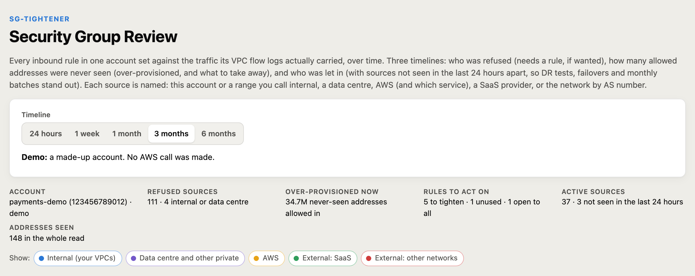
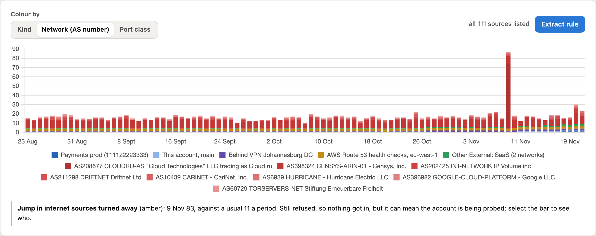
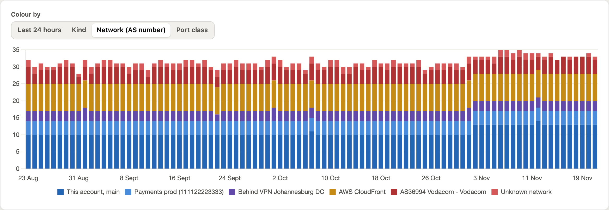
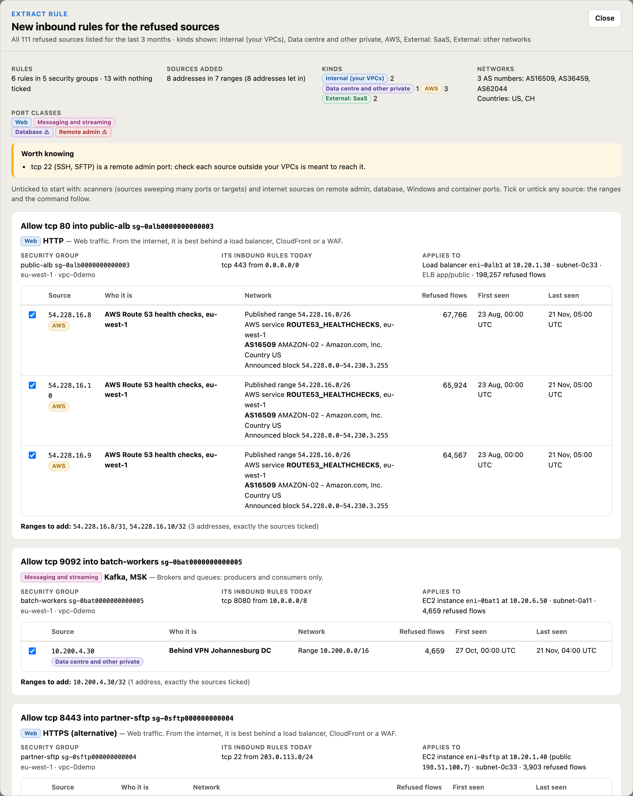
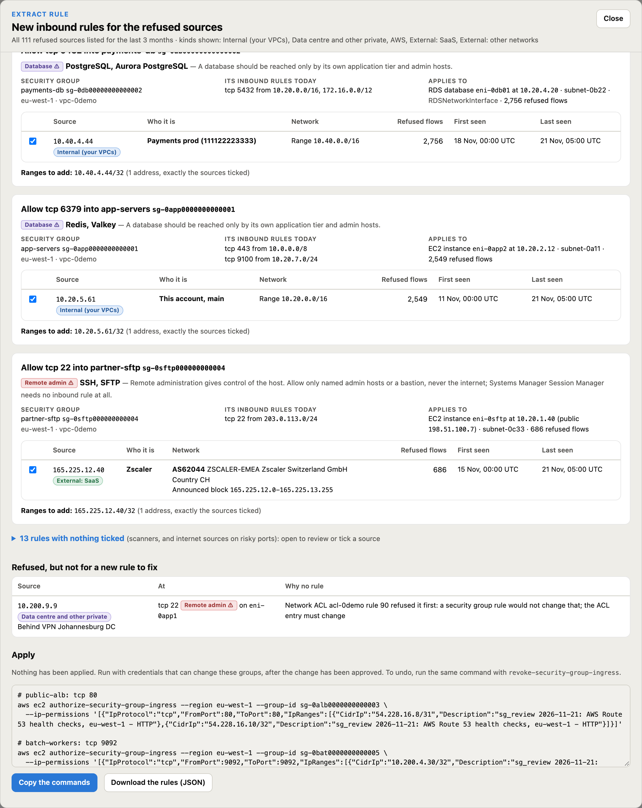

# Security Group Review (`sg_review.py`)

`sg_review.py` sets every inbound security group rule in one account against the traffic the
account's VPC flow logs carried. It writes the result as **one self-contained HTML page** with three
timelines and a table of what to change. The page needs no server and no sign-in: open it in any
browser, offline, or attach it to a change request.

It is read-only. It uses your normal AWS credentials (`aws sso login`, a `--profile`, or the
environment), not a login of its own.



*Every image on this page comes from `python sg_review.py demo`, a made-up account, set to 3 months.*

---

## Making the graphs in three commands

```bash
# 1. Read one day first. It measures how many bytes of flow log the account writes per second,
#    so that longer reads can be costed before you pay for them.
python sg_review.py read --regions eu-west-1 --days 1

# 2. Read further back. Only time not already read is read. You see the estimated cost and
#    type "yes" to go ahead.
python sg_review.py read --regions eu-west-1 --days 90

# 3. Write the page. This makes no AWS call.
python sg_review.py report --onprem "10.200.0.0/16 Johannesburg DC" \
                           --internal "10.40.0.0/16 Payments prod"
# -> sg-review-<account>.html
```

To see the page without AWS access:

```bash
python sg_review.py demo            # -> sg-review-demo.html
```

---

## The parameters, and what each one changes on the page

### `read`: what the graphs can show

| Parameter | Values | Effect on the graphs |
|---|---|---|
| `--regions` | `eu-west-1,us-east-1` | Which regions' security groups and flow logs are read. All regions appear on one page, and approved.json downloads are per region |
| `--days` | `1`, `7`, `30`, `90`, `180` (default `1`) | How far back is read. It decides which **Timeline** buttons work: `1` gives 24 hours; `7` adds 1 week; `30` adds 1 month; `90` adds 3 months; `180` adds 6 months. Buttons for ranges not read are greyed out. Rules are only called *unused* or *Tighten* after 30 days of evidence |
| `--profile` | an AWS profile | The credentials to read with. The account is whichever one those credentials belong to |
| `--name` | text | The account name shown in the header (default: the account alias) |
| `--yes` | flag | Skip typing `yes` after the cost estimate, for scheduled runs |

You can run `read` again at any time. Only the gap since the last read is read, so a daily run
costs one day of Logs Insights. Logs Insights costs about US$0.005 per GB scanned. Press Ctrl-C to
stop a read; the slices already read are kept.

### `report`: how sources are named and coloured

| Parameter | Example | Effect on the graphs |
|---|---|---|
| `--onprem` | `"10.200.0.0/16 Johannesburg DC, 10.201.0.0/16 Cape Town DC"` | These ranges count as **Data centre** (purple) and are labelled with your name for them. Ranges behind the account's VPN connections are added automatically |
| `--internal` | `"10.40.0.0/16 Payments prod"` | Your other accounts' ranges count as **Internal** (blue), the same as the account's own VPCs |
| `--offline` | flag | Do not refresh the public lists that name AWS services, SaaS providers and AS numbers. A few well-known ranges are used instead, and the page says so |
| `--account` | `123456789012` | Which account's read to report, if you have read more than one |
| `--out` | `review.html` | Output file (default `sg-review-<account>.html`) |

Ranges are separated by commas. Each one is a CIDR, then a space, then a name.

### Other commands

| Command | What it does |
|---|---|
| `approved --region R [--account ID] [--out approved.json]` | Writes sg-tightener's `approved.json` from the review, ready for `sg_tightener.py plan`. The same file can be downloaded from the page |
| `demo [--offline] [--out FILE]` | The page for a made-up account |
| `forget --account ID` | Deletes what was read for that account |
| `--data-dir DIR` (before the command) | Where reads and address lists are kept (default `~/.sg-tightener`) |

---

## On the page

The **Timeline** buttons switch the graphs between 24 hours (hourly bars), 1 week (6-hour bars),
and 1, 3 or 6 months (daily bars). The **Show** chips switch each kind of source on or off in every
graph and table. The kinds are internal, data centre, AWS, SaaS and other networks.

### Who each address is

Every source address is attributed, on the computer that writes the page, from these lists:

| Kind | How it is recognised | What the page shows |
|---|---|---|
| **Internal** | The account's own VPC ranges, and the ranges given with `--internal` | The VPC or your name for the range, and the range |
| **Data centre** | The ranges given with `--onprem`, the routes of the account's VPN connections, and any other private address | Your name for the range (for example "Johannesburg DC" or "Behind VPN …"), and the range |
| **AWS** | AWS's published `ip-ranges.json` | The AWS service and region (for example "Route 53 health checks, eu-west-1"), the published prefix, and the AS number |
| **SaaS** | Providers' published ranges (GitHub, Cloudflare, Google, Atlassian, Okta, Datadog, Fastly and others), then well-known provider AS numbers | The provider, the published prefix, and the AS number |
| **Other networks** | Everything else | The **AS number and owner**, the country, and the block that network announces |

### Colour by: kind, network or port class

The refused and active graphs each have a **Colour by** switch:

- **Kind**: the five kinds above. On the active graph, **Last 24 hours** instead splits sources
  seen in the last day from those not seen in it.
- **Network (AS number)**: the ten busiest networks among the kinds shown, each one named: an AS
  number and its owner, an AWS service, a SaaS provider, or one of your named ranges. Each kind
  keeps its own colour, in darker and lighter shades, and the remaining networks of each kind are
  summed as "Other".
- **Port class**: what the destination port is for (see [Ports](#4-ports)). Ports marked ⚠ give
  control of a host or its data when reached.

Selecting a bar lists that period's sources. Selecting one colour in a bar narrows the list to that
kind, network or port class.




### 1. Refused sources


These are distinct addresses turned away in each period. A refused address needs a rule only if
the traffic is wanted:

- **Internal and data centre** sources usually are wanted, for example a new service or a moved server.
- **Other networks** are drawn in grey: this is the defences working.
- A period with more than five times the usual number of refused internet sources (and at least 20)
  turns amber and is named under the graph, because it can mean the account is being probed.

Select a bar to list who was refused. The table below the graph suggests a rule for internal and
data centre sources. **Extract rule** turns any of the refused sources into rules you can apply;
see [Extract rule](#extract-rule) below.

### 2. Over-provisioned addresses


This graph counts addresses the rules let in that were **never seen anywhere in the account**. It
is summed over every security group that has flow logs on all its interfaces.

- The rules in force on each day are worked back from today's rules using CloudTrail's record of
  rule changes. Each triangle is a change; select one to see it.
- Rules open to `0.0.0.0/0` are listed in the rules table and not counted here.
- The scale is logarithmic, so each step down is a tenfold cut.

### 3. Active sources


These are distinct addresses let in during each period.

- **Dark** bars are sources that were also seen in the last 24 hours.
- **Light** bars are sources not seen in the last 24 hours. These are the ones a rule change would
  break without warning: DR tests, failovers and month-end batches.

Replies to the account's own outbound connections are left out.



### 4. Ports


These two graphs show the 15 busiest destination ports over the timeline. One counts the sources
refused on each port and the other the sources let in. Each bar is labelled with the protocol,
port and service, for example `tcp 5432 · PostgreSQL, Aurora PostgreSQL`, and is coloured by its
class. The table under them lists every class seen, the ports in it, and what reaching it means.

| Class | Examples | Marked ⚠ |
|---|---|---|
| Web | 80, 443, 8080, 8443 | |
| Remote admin | 22 SSH, 3389 RDP, 5985/5986 WinRM, 5900 VNC, 23 Telnet | Yes |
| Database | 1433 SQL Server, 1521 Oracle, 3306 MySQL, 5432 PostgreSQL, 6379 Redis, 27017 MongoDB, 9200 OpenSearch | Yes |
| Windows and directory | 135 RPC, 139/445 SMB, 389/636 LDAP, 88 Kerberos, 3268 global catalog | Yes |
| Containers | 2375/2376 Docker, 2379 etcd, 6443 Kubernetes API, 10250 kubelet, 30000-32767 NodePort | Yes |
| File transfer and storage | 21 FTP, 2049 NFS/EFS, 873 rsync, 3260 iSCSI | |
| Mail | 25, 465, 587, 110, 143, 993, 995 | |
| Messaging and streaming | 5672 AMQP, 9092 Kafka/MSK, 1883 MQTT, 2181 ZooKeeper | |
| Network and monitoring | 53 DNS, 123 NTP, 161 SNMP, 514 syslog, 500/4500 IPsec, 9090/9100 Prometheus, ICMP | |
| Other | well-known (1-1023), registered (1024-32767), high (32768+) | |

A class names what the port usually carries, not what is actually listening on it. The class and
service also appear next to every port in the tables, and in the rules CSV.

### The rules table


Each rule gets one of these statuses:

- **Tighten**: a private rule wider than /24, or a public range, with addresses never seen. The
  suggested ranges come from sg-tightener's fitting and keep every address seen, with headroom.
- **Unused**: nothing matched the rule in the evidence window.
- **Open to all**
- **In use**
- **Not logged**: some of the group's interfaces have no flow log.

Use **Download the rules (CSV)** to share the table. Use **approved.json, &lt;region&gt;** to take
the suggestions straight into the usual sg-tightener flow:

```bash
python sg_tightener.py plan --region eu-west-1 --approved approved.json --out plan.json
```

### Extract rule

**Extract rule**, above the refused graph, turns the refused sources listed into inbound rules that
would let them in. What it uses is exactly what the list below the graph shows: the **Show** chips,
the bar selected, and the colour selected in it. With nothing selected, it uses every refused source
in the timeline. Each row of the refused table also has its own **Extract rule** button, for one
source.



For each proposed rule (one per security group, protocol and port) the window shows:

- **The port**: its class and service, and what reaching that class means.
- **The security group**: name, id, region and VPC, and its inbound rules today. When the
  interfaces refused have more than one group, you can choose which group gets the rule.
- **The assets it applies to**: each interface refused, with its kind (EC2 instance, RDS database,
  load balancer and so on), private and public address, subnet, description, and refused flows.
- **Every source**, with a tick box: the address, its kind, who it is, and everything known about
  its network. That means the published range and the AWS service and region; or the AS number,
  owner, country and announced block; or your named range. It also shows the refused flows, when the
  source was first and last seen, and whether it is sweeping many ports (a scanner).
- **The ranges to add**: the ticked sources as the fewest CIDR blocks that hold exactly those
  addresses and no others.

At the top, the window totals the rules, addresses, kinds, AS numbers, countries and port classes.
Two boxes flag what to check before adding:

- **Check before adding**: internet sources on remote admin, database, Windows or container ports,
  and scanners.
- **Worth knowing**: AWS EC2 addresses, which can belong to any AWS customer; risky ports reached
  from outside your VPCs; interfaces with several security groups; and whether the page lists only
  the busiest refused sources.

Scanners, and internet sources on ⚠ ports, start **unticked**. Rules with nothing ticked are folded
away at the bottom. Sources a new security group rule would not let in are listed separately with the
reason: a network ACL refused them first, a rule added since already allows them, the interface was
deleted, or the port is 32768 or higher, where ports are read as one.



**Nothing is applied.** The window writes one `aws ec2 authorize-security-group-ingress` command per
security group, ready to copy. Each range carries a description naming its sources and the
service, for example `sg_review 2026-11-21: Behind VPN Johannesburg DC - Kafka, MSK`. **Download the
rules (JSON)** saves the same rules with the full attribution of every source and asset, and the
sources left out with the reason. To undo a rule, run the same command with
`revoke-security-group-ingress`.

---

## Where things are kept

| Path | Contents |
|---|---|
| `~/.sg-tightener/review/<account>.json.gz` | What was read: flow-log slices, security groups, interfaces, VPCs, rule changes. Mode 0600 in a 0700 directory |
| `~/.sg-tightener/ipintel/` | The public address lists (AWS, SaaS providers, AS numbers), refreshed daily (AS numbers weekly) |
| `sg-review-<account>.html` | The page. It describes your network, so treat it as confidential |

The permissions needed are in [permissions.md](permissions.md). Every flag is in the
[CLI reference](cli-reference.md#sg_reviewpy).
