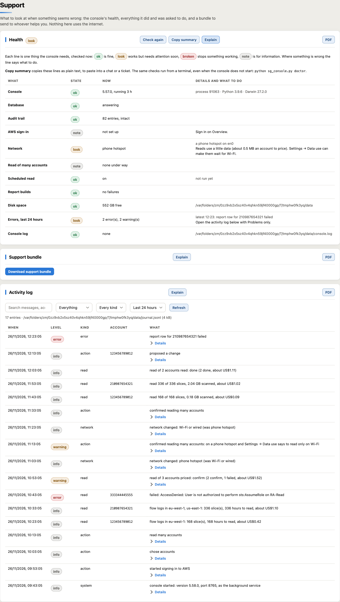

# Troubleshooting and support

How to own the console day to day: where to look when something seems wrong, what each symptom usually
means, and what to send when you ask for help.

**Start here, every time:**

1. Open the console's **Support** tab. The **Health** card checks everything the console needs and says
   what to do about anything that is not right.
2. If the console does not open at all, run this in a terminal from the repository folder:

   ```bash
   python sg_console.py doctor
   ```

   It runs the same checks without the console (Python, packages, the data folder, the database, whether
   the console answers, Always running, the size of the log) and prints the last problems from the
   activity log when the console is down.
3. Still stuck? Write a support bundle (button on **Support**, or `python sg_console.py support`) and send
   it to whoever helps you.



---

## What the console keeps, and where

Everything is under the data folder, `~/.sg-tightener` unless `--data-dir` says otherwise.

| What | Where | Notes |
|---|---|---|
| Security groups, rules, change requests, the **audit trail**, flow logs read, reports | PostgreSQL (`sg_store.py setup` runs it in Docker on port 55432) | The audit trail is append-only and hash-chained; flow logs are kept 365 days |
| How to reach the database | `pg.dsn` (or `$SG_TIGHTENER_PG_DSN`, which wins) | Readable only by you |
| The **activity log** | `journal.jsonl` and `journal.1.jsonl` | One JSON object a line; rotated at 2 MB, so about the last 4 MB are kept. Works with the database down |
| The console's own log | `console.log` | Everything the background service prints. Start here for a crash at start-up |
| Backups | `backups/*.dump` | `python sg_store.py backup` / `restore FILE --yes`; the newest 14 are kept |
| AWS sign-in | `sso.json`, `keys.json` | Tokens, never sent anywhere but AWS |
| The copy the background service runs | `app/` | `python sg_console.py install` refreshes it from the repository |

### Activity log or audit trail?

| | Audit trail | Activity log |
|---|---|---|
| Records | Every security group change: who, why, the ticket, the rules, changes made outside the tool | What the console did and was asked to do: buttons pressed (how long, did it work), reads priced, confirmed, stopped, finished, the scheduled read, sign-in, the network changing, starts and stops, every warning and error with its traceback |
| For | Compliance and change control | Running and fixing the console |
| Kept | For ever, hash-chained (tampering shows) | The last ~4 MB, rotated |
| Lives in | PostgreSQL | A file, so it is there when the database is not |
| Seen on | **Audit trail** tab | **Support** tab |

---

## Symptoms

### The page does not open

- Run `python sg_console.py doctor`. Usually one of:
  - **The console is not running**: `python sg_console.py install` (always running) or `python sg_console.py serve`.
  - **It starts and dies**: the reason is at the end of `~/.sg-tightener/console.log`. A Python error at
    start-up usually means a package is missing: `pip install -r requirements.txt`, then `install` again.
  - **The port is taken** (another copy, or another program on 8765): `lsof -nP -iTCP:8765 -sTCP:LISTEN`
    shows who; `--port` picks another.

### "The database is not running"

The page shows a banner with **Start the database** when it can start it (Docker or Colima installed). If
not: start Docker Desktop (or `colima start`), then `python sg_store.py setup`. A database elsewhere (team
server): Settings → Database → **Test**. Everything else waits for it; the activity log does not.

### "Something went wrong here" or an HTTP 500

The error and its traceback are on **Support → Activity log**: choose **Problems only**, open **Details**.
The same is in `console.log`. Send the support bundle if it is not obvious.

### A read of many accounts is slow

- **Pricing** costs about 0.5 MB of AWS calls and a few seconds an account; 150 accounts take several
  minutes. **Reading** depends on the flow logs: AWS scans them on its side.
- **Do not upgrade or restart during a read.** A restart stops it; it carries on at the next start, but an
  account priced by an older version (before 5.57.0) is priced again from the start. From 5.57.0 each price
  is kept (Settings → Data use → Keep prices).
- A busy Mac slows everything: Settings → **Database and computer, now** shows the load. Report builds run
  in the background at low priority; fewer workers (Settings → Performance) leave more for the read.
- The activity log has a line for each account as it is priced and read (kind **read**): search for an
  account id to follow one.

### A read waits and does not start

- **Not signed in to AWS**, or the sign-in ran out: sign in again on Overview. The **Health** card shows how
  long the sign-in has left; renew it before a long read.
- **On a phone hotspot** with Settings → Data use → *Read only on Wi-Fi* on: it starts once on Wi-Fi. The
  activity log records the network changing (kind **network**).
- **Another read is under way**: the scheduled read waits for it.

### Signing in fails (behind Zscaler)

A company sign-in that allows only Zscaler's addresses fails when Zscaler is off: switch it on, then
sign in. The sign-in page checks this first ([details](console.md#signing-in-behind-zscaler)). Some other
tools (SSH to a home server, for one) fail while Zscaler is on: switch it off only for those.

### Accounts failed in a read of many accounts

**Support → Health → Read of many accounts** counts them; each failed account's reason is in the activity
log (kind **read**, level **error**). Usual reasons: the role is not in that account (choose it on
Overview), the account has no VPC flow logs in CloudWatch Logs, or AWS throttled the queries (read it
again later).

### Reports are missing or old

Reports are rebuilt in the background after each read. Settings → Performance shows the latest builds and
their failures; each failure is in the activity log with its traceback. **Retry** on the page builds the
missing ones again.

### "The audit trail is broken"

An entry was changed or removed outside the tool (straight in the database). The tool never does this.
Stop making changes, take a backup (`python sg_store.py backup`), and report it: the message names the
first entry that does not match.

### The disk fills up

The database holds a year of flow-log reads. **Health → Disk space** warns under 10 GB free. Settings →
**Database and computer, now** shows which tables are largest. Old backups in `backups/` can go.

---

## Upgrading safely

1. Check nothing is reading: **Support → Health → Read of many accounts** says *none under way*,
   *finished* or *stopped* (or `curl -s http://127.0.0.1:8765/api/health`).
2. `git pull`, then `python sg_console.py install`. The console restarts; an open page reconnects by itself.
3. **Support → Health** shows the new version. The activity log records the stop and the start.

If the activity log says *the console before this one ended without stopping*, the previous run crashed or
was killed: the entries just before that line usually say why.

## Asking for help

Send the support bundle (`sg-tightener-support-YYYYMMDD-HHMMSS.zip`). It holds:

| File | What |
|---|---|
| `health.json` | The Support tab's checks |
| `settings.json` | The console's settings, connection strings masked |
| `activity.json` | The activity log, newest first |
| `console.log` | The last 400 kB of the console's log |
| `versions.json` | Versions of the tool, Python and its packages; which environment variables are set (not their values); the reads under way |

Tokens, AWS keys and passwords are replaced by `***` before anything is written. Account ids and security
group ids are kept, because they are needed to follow what happened: look inside before sending it outside
your company.
